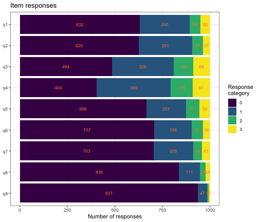
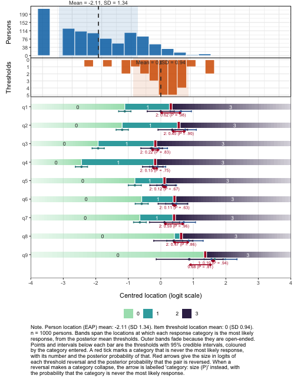
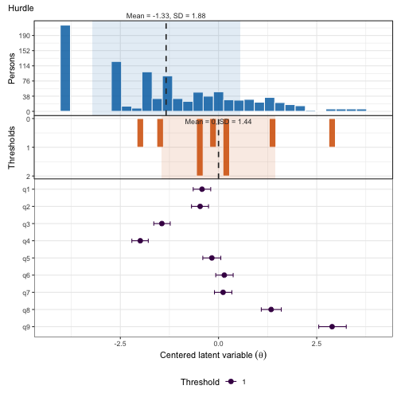
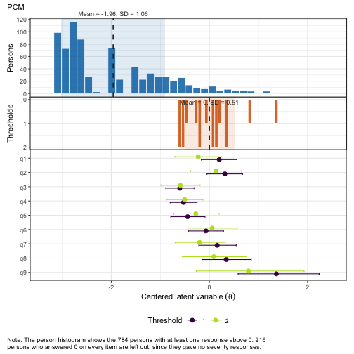
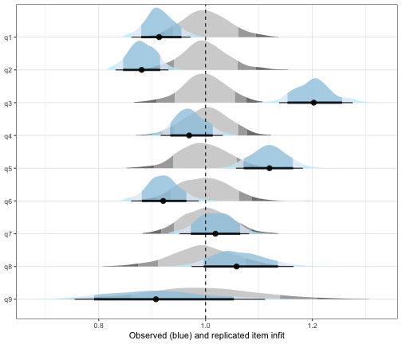
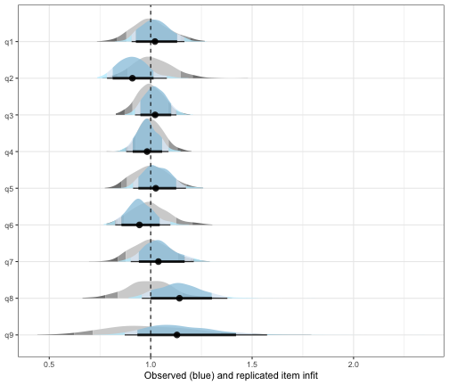
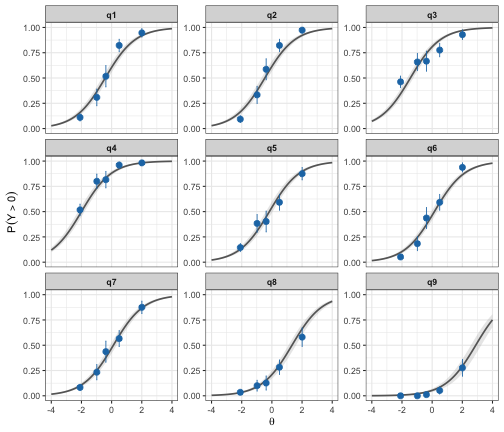
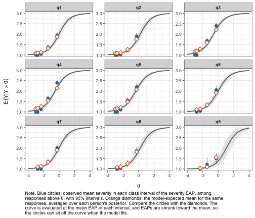
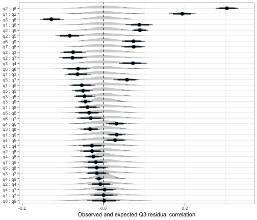
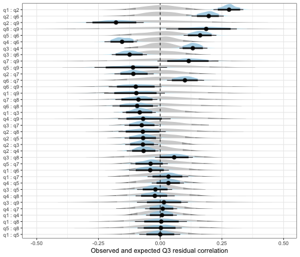

```{=html}
<style>
/* Journal-style figure captions: subtle left rule + muted colour */
.figure p.caption,
div.figure > p.caption,
figure > figcaption {
  font-size: 0.95em;
  padding-left: 0.75em;
  border-left: 3px solid #ccd;
  color: #555;
  margin-top: 0.5em;
  margin-bottom: 1.25em;
  line-height: 1.4;
}
</style>
```

## Overview

Symptom questionnaires given to a general population sample often have many
responses in the lowest category. On the PHQ-9 depression screener, most
people answer "Not at all" to most items. A partial credit model (PCM)
treats the step from 0 to 1 as one more threshold on the same latent
variable as the steps between the higher categories. That may not hold. Not
having a symptom at all and how often a present symptom occurs can be
different processes.

The hurdle partial credit model (hPCM) separates the two. For each person
and item:

- a **hurdle** submodel, a dichotomous Rasch model, gives the probability
  of any response above 0 (the symptom is present), and
- a **severity** submodel, a partial credit model, gives the probability of
  each category 1, 2, 3 given that the response is above 0.

For person $p$ and item $i$ with categories $0, 1, \dots, m_i$, the
hurdle submodel is

$$
\operatorname{logit} P(Y_{pi} > 0) = \zeta_p - \delta_i ,
$$

where $\zeta_p$ is the person's hurdle location and $\delta_i$ the item's
hurdle location. Given a response above 0, the severity submodel is

$$
P(Y_{pi} = k \mid Y_{pi} > 0) =
\frac{\exp \sum_{j=2}^{k} (\theta_p - \tau_{ij})}
     {\sum_{h=1}^{m_i} \exp \sum_{j=2}^{h} (\theta_p - \tau_{ij})},
\qquad k = 1, \dots, m_i ,
$$

where $\theta_p$ is the person's severity location, $\tau_{ij}$ is the
threshold between categories $j - 1$ and $j$, and an empty sum is 0. Item
$i$ thus has $m_i - 1$ severity thresholds, two for the PHQ-9 items. The
person locations follow a bivariate normal distribution,

$$
\begin{pmatrix} \zeta_p \\ \theta_p \end{pmatrix} \sim
\mathcal{N}\left(
\begin{pmatrix} 0 \\ 0 \end{pmatrix},
\begin{pmatrix} \sigma_\zeta^2 & \rho \sigma_\zeta \sigma_\theta \\
\rho \sigma_\zeta \sigma_\theta & \sigma_\theta^2 \end{pmatrix}
\right).
$$

Each submodel thus has its own person location, and the two are allowed to
correlate. The correlation shows whether presence and severity are close to
the same trait or two distinct ones. The two correlated traits come from
the zero-inflated graded response model of
@magnus_multidimensional_2022. The hPCM is the Rasch counterpart of the
hurdle version of that model [@magnus_symptom_2022], with partial credit
in place of graded response. In a hurdle model every zero comes from the
hurdle submodel: everyone can have the symptom, and a zero means that it was not reported,
not that it could not occur.

The model is fitted with the custom `brms` [@burkner_bayesian_2021] family `hurdle_acat()`,
contributed by Kristoffer Magnusson. The functions with the suffix `_hpcm`
analyse the fitted model.

**brms version.** On CRAN `brms` (2.23), custom ordinal families with
grouped thresholds produce invalid Stan code. Until a fixed version is on
CRAN, install the patched branch to run the code in this vignette:


``` r
remotes::install_github("rpsychologist/brms@fix-custom-ordinal-grouped-thres")
```

The output shown here was computed beforehand with that version. For the
standard Rasch workflow, see the
[partial credit model vignette](pcm-rasch-analysis.html).


``` r
library(easyRaschBayes)
library(brms)
library(dplyr)
library(tidyr)
library(tibble)
library(ggplot2)
```

## Data

`phq9_nhanes` is a simple random sample of 1000 respondents to the PHQ-9 [@kroenke_phq9_2001] in
the U.S. National Health and Nutrition Examination Survey (NHANES,
September 2024 release), drawn from everyone who answered all nine items. There was no
selection on scores, so the share of zero responses is that of a general
population sample. See `?phq9_nhanes`. Each item is scored 0 ("Not at
all"), 1 ("Several days"), 2 ("More than half the days") and 3 ("Nearly
every day").


``` r
data(phq9_nhanes)
items <- phq9_nhanes[, 1:9]

sum_score <- rowSums(items)
summary(sum_score)
#>    Min. 1st Qu.  Median    Mean 3rd Qu.    Max. 
#>   0.000   1.000   3.000   4.416   6.250  24.000
mean(sum_score == 0)  # share with a sum score of zero
#> [1] 0.216
round(colMeans(items == 0), 2)  # share of zero responses per item
#>   q1   q2   q3   q4   q5   q6   q7   q8   q9 
#> 0.63 0.62 0.48 0.40 0.67 0.71 0.70 0.84 0.94
```


``` r
plot_stackedbars(items)
```

<div class="figure">

<p class="caption">**Figure 1.** *Response distribution per item*</p>
</div>

The highest categories are rare for several items. On `q9` (thoughts of
being better off dead or of self-harm), about 1% chose "Nearly every
day". The severity submodel estimates its thresholds from the responses
above 0 only, so these thresholds will be uncertain.

For `brms`, the data go to long format, one row per person and item. The
hurdle family uses the responses as they are, coded from 0, since category
0 is the hurdle. The ordinary PCM below needs categories starting at 1, so
it gets a separate response column.


``` r
df_hpcm <- items %>%
  rownames_to_column("id") %>%
  pivot_longer(!id, names_to = "item", values_to = "response") %>%
  mutate(response_pcm = response + 1)

head(df_hpcm)
#> # A tibble: 6 × 4
#>   id    item  response response_pcm
#>   <chr> <chr>    <int>        <dbl>
#> 1 1     q1           0            1
#> 2 1     q2           0            1
#> 3 1     q3           1            2
#> 4 1     q4           0            1
#> 5 1     q5           0            1
#> 6 1     q6           0            1
```

## A partial credit model first

To see the problem the hurdle model addresses, we first fit an ordinary
PCM.


``` r
fit_pcm <- brm(
  response_pcm | thres(gr = item) ~ 1 + (1 | id),
  data   = df_hpcm,
  family = acat,
  prior  = prior("normal(0, 3)", class = "Intercept") +
    prior("normal(0, 3)", class = "sd", group = "id"),
  chains = 4, cores = 4, iter = 2000
)
saveRDS(fit_pcm, "fits/fit_pcm_nhanes.rds")
```


``` r
fit_pcm <- readRDS("fits/fit_pcm_nhanes.rds")
```


``` r
plot_targeting(fit_pcm, height_ratios = c(2, 1.5, 7))
```

<div class="figure">

<p class="caption">**Figure 2.** *Targeting, partial credit model*</p>
</div>

The 216 persons with a sum score of zero all get the same, lowest,
location and form the spike at the left of the person histogram. The PCM
cannot tell them apart. The item panel shows a second problem: for eight
of the nine items, category 2 ("More than half the days") is never the
most likely response, because its thresholds are disordered. The PCM places
the step from 0 to 1 and the steps between the higher categories on one
scale, and in these data they do not line up.


``` r
infit_pcm <- infit_post(infit_statistic(fit_pcm, ndraws_use = 500))
infit_pcm$summary
#> # A tibble: 9 × 4
#>   item  infit_obs infit_rep infit_ppp
#>   <chr>     <dbl>     <dbl>     <dbl>
#> 1 q1        1.04      1         0.758
#> 2 q2        0.797     1.01      0.002
#> 3 q3        1.27      0.997     1    
#> 4 q4        1.01      0.999     0.566
#> 5 q5        1.17      1         0.994
#> 6 q6        0.872     1.00      0.046
#> 7 q7        1.04      1.00      0.706
#> 8 q8        1.18      1.00      0.93 
#> 9 q9        0.922     1.00      0.32
```


``` r
rest_pcm <- item_restscore_post(item_restscore_statistic(fit_pcm, ndraws_use = 500))
rest_pcm$summary
#> # A tibble: 9 × 6
#>   item  gamma_obs gamma_exp gamma_diff   ppp p_adj
#>   <chr>     <dbl>     <dbl>      <dbl> <dbl> <dbl>
#> 1 q1        0.698     0.665      0.033 0.934 0.772
#> 2 q2        0.757     0.659      0.098 1     0    
#> 3 q3        0.561     0.678     -0.117 0     0    
#> 4 q4        0.689     0.682      0.007 0.634 1    
#> 5 q5        0.612     0.674     -0.063 0     0.008
#> 6 q6        0.74      0.667      0.073 0.998 0.006
#> 7 q7        0.683     0.665      0.018 0.77  0.99 
#> 8 q8        0.689     0.674      0.016 0.7   1    
#> 9 q9        0.843     0.677      0.166 1     0.008
```

Infit and item-restscore agree on the items that fit worst. `q3` (sleep)
underfits, with infit around 1.27 and an item-restscore gamma below its
expected value. `q5` (appetite) shows the same pattern, less strongly.
`q2` (feeling down) and `q6` (feeling bad about yourself) overfit, and so
does `q9` by item-restscore. Overfit and underfit are related here: items
in a strongly dependent pair usually overfit, which makes the other items
look more underfit, and `q2` and `q6` form such a pair (see local
dependence below). Part of the misfit may also come from forcing presence
and severity onto one scale, which the hurdle model relaxes.

## Fitting the hurdle PCM

The hurdle submodel is given by the `hu` formula. `0 + factor(item)` gives
each item its own hurdle difficulty, and `(1 |g| id)` in both formulas gives
each person one location per submodel, with the label `g` telling `brms`
to estimate their correlation. `thres(gr = item)` gives each item its own
severity thresholds, as in the PCM.


``` r
prior_hpcm <- prior("normal(0, 3)", class = "Intercept") +
  prior("normal(0, 3)", class = "b", dpar = "hu") +
  prior("normal(0, 3)", class = "sd", group = "id") +
  prior("normal(0, 3)", class = "sd", group = "id", dpar = "hu") +
  prior("lkj(2)", class = "cor")
```


``` r
fit_hpcm <- brm(
  bf(
    response | thres(gr = item) ~ 1 + (1 |g| id),
    hu ~ 0 + factor(item) + (1 |g| id)
  ),
  data     = df_hpcm,
  family   = hurdle_acat(),
  stanvars = hurdle_acat_stanvars(),
  prior    = prior_hpcm,
  chains   = 4, cores = 4, iter = 2000
)
saveRDS(fit_hpcm, "fits/fit_hpcm.rds")
```


``` r
fit_hpcm <- readRDS("fits/fit_hpcm.rds")
```

**Sign convention.** In `brms`, the person effect in the `hu` formula is on
the logit of P(response = 0), so a higher value means more zeros. The
`_hpcm` functions flip the sign of the person locations and the
correlation, so that a higher hurdle location means a symptom is more
likely to be present. Item hurdle locations keep the `brms` direction: a
higher value means more zeros, a harder hurdle to cross. These are
$\zeta_p$ and $\delta_i$ in the model above.

## Presence and severity: one trait or two?


``` r
ipar <- item_parameters_hpcm(fit_hpcm)
ipar$correlation
#> # A tibble: 1 × 4
#>    mean     sd hdci_lower hdci_upper
#>   <dbl>  <dbl>      <dbl>      <dbl>
#> 1 0.655 0.0422      0.570      0.736
```

`ipar$correlation` summarises the posterior of the correlation between the
hurdle and severity person locations. A correlation close to 1 means that
presence and severity are close to one trait, and the two submodels mainly
differ in how the item thresholds are arranged. A clearly lower correlation
means that knowing whether someone has symptoms says only part of how
severe they are, and the two locations should be reported separately.

Here the correlation is 0.66, with a 95% interval from 0.57 to 0.74. The
two are related, but far from the same trait. Someone who reports many
symptoms does not necessarily report them as frequent.

## Item parameters


``` r
knitr::kable(ipar$hurdle$summary)
```


|item | threshold| location|     se| hdci_lower| hdci_upper| n_eff|
|:----|---------:|--------:|------:|----------:|----------:|-----:|
|q1   |         1|  -0.4197| 0.1133|    -0.6377|    -0.1926|  1954|
|q2   |         1|  -0.4689| 0.1101|    -0.6896|    -0.2567|  1749|
|q3   |         1|  -1.4427| 0.1054|    -1.6399|    -1.2256|  1974|
|q4   |         1|  -1.9925| 0.1072|    -2.2066|    -1.7885|  2011|
|q5   |         1|  -0.1698| 0.1162|    -0.3889|     0.0742|  2021|
|q6   |         1|   0.1470| 0.1139|    -0.0684|     0.3745|  1892|
|q7   |         1|   0.1163| 0.1146|    -0.0916|     0.3524|  2032|
|q8   |         1|   1.3388| 0.1302|     1.0876|     1.5955|  2289|
|q9   |         1|   2.8916| 0.1789|     2.5343|     3.2298|  2946|


``` r
knitr::kable(ipar$pcm$locations_wide)
```


|item |      t1|      t2| location|
|:----|-------:|-------:|--------:|
|q3   | -0.6051| -0.5922|  -0.5986|
|q4   | -0.5274| -0.5039|  -0.5157|
|q5   | -0.4432| -0.2768|  -0.3600|
|q7   |  0.1575| -0.2027|  -0.0226|
|q1   |  0.2000| -0.2275|  -0.0138|
|q6   | -0.0690|  0.0543|  -0.0074|
|q8   |  0.3421|  0.0883|   0.2152|
|q2   |  0.3154|  0.1316|   0.2235|
|q9   |  1.3642|  0.7945|   1.0793|


The hurdle table gives one difficulty per item. Items with high values are
those most people do not endorse at all. `q4` (feeling tired) is the
easiest symptom to report (-2.0) and `q9` (thoughts of self-harm) by far
the hardest (2.9). The severity table gives the thresholds between
categories 1 and 2 and between 2 and 3, for those who endorsed the item.


``` r
ipar$pcm$threshold_order
#> # A tibble: 9 × 4
#>   item  n_thresholds ordered prob_disordered
#>   <chr>        <int> <lgl>             <dbl>
#> 1 q1               2 FALSE             0.915
#> 2 q2               2 FALSE             0.716
#> 3 q3               2 TRUE              0.474
#> 4 q4               2 TRUE              0.466
#> 5 q5               2 TRUE              0.292
#> 6 q6               2 TRUE              0.352
#> 7 q7               2 FALSE             0.844
#> 8 q8               2 FALSE             0.708
#> 9 q9               2 FALSE             0.756
```

Among those who report a symptom, the two severity thresholds are close
together, and for `q1`, `q7`, `q9`, `q2` and `q8` the posterior probability
that they are disordered is above 0.7. Separating out the zeros does not
remove the weak middle category. It suggests that "More than half the
days" is hard to tell apart from its neighbours.

## Targeting


``` r
targ <- plot_targeting_hpcm(fit_hpcm)
targ$hurdle
```

<div class="figure">

<p class="caption">**Figure 3.** *Targeting, hurdle submodel*</p>
</div>


``` r
targ$pcm
```

<div class="figure">

<p class="caption">**Figure 4.** *Targeting, severity submodel*</p>
</div>

In the hurdle plot, the item difficulties spread from about -2 to 3 and
cover most of the persons. The persons who answered 0 on every item still
form a spike at the low end, but the rest of the distribution is spread
out, unlike in the PCM. The severity plot shows only the 784 persons with
at least one response above 0. Their mean severity is about 2 logits below
the mean threshold: most of those who report symptoms report them as
occurring on "Several days", so the severity thresholds are targeted
above most of the sample. The category bands show the disordered
severity thresholds from above: for `q1`, `q2`, `q7`, `q8` and `q9`, category 2 is
marked in red, with posterior probabilities from 0.71 to 0.91 that it is
never the most likely response.

## Item fit

`infit_statistic_hpcm()` computes posterior predictive infit for each
submodel. The hurdle infit uses all responses, with 0 versus above 0 as the
outcome. The severity infit uses only the responses above 0. Each part is
summarised with `infit_post()`.


``` r
infit_hpcm <- infit_statistic_hpcm(fit_hpcm, ndraws_use = 500)

infit_hu <- infit_post(infit_hpcm$hurdle)
infit_hu$summary
#> # A tibble: 9 × 4
#>   item  infit_obs infit_rep infit_ppp
#>   <chr>     <dbl>     <dbl>     <dbl>
#> 1 q1        0.915     1.00      0.04 
#> 2 q2        0.881     0.999     0.01 
#> 3 q3        1.20      0.998     1    
#> 4 q4        0.971     1.00      0.242
#> 5 q5        1.12      0.996     0.988
#> 6 q6        0.922     0.997     0.1  
#> 7 q7        1.02      1.00      0.606
#> 8 q8        1.06      0.995     0.804
#> 9 q9        0.914     0.997     0.256
infit_hu$plot
```

<div class="figure">

<p class="caption">**Figure 5.** *Infit, hurdle submodel*</p>
</div>


``` r
infit_sev <- infit_post(infit_hpcm$pcm)
infit_sev$summary
#> # A tibble: 9 × 4
#>   item  infit_obs infit_rep infit_ppp
#>   <chr>     <dbl>     <dbl>     <dbl>
#> 1 q1        1.02      1.00      0.58 
#> 2 q2        0.912     1.01      0.21 
#> 3 q3        1.02      0.997     0.632
#> 4 q4        0.984     1.00      0.406
#> 5 q5        1.03      1.00      0.614
#> 6 q6        0.949     0.996     0.334
#> 7 q7        1.04      1.00      0.618
#> 8 q8        1.15      0.999     0.834
#> 9 q9        1.16      1.01      0.68
infit_sev$plot
```

<div class="figure">

<p class="caption">**Figure 6.** *Infit, severity submodel*</p>
</div>

Unlike `infit_statistic()` for Rasch models, these expected values use the
person locations in each posterior draw, not the total score. The total
score is not sufficient for the person locations in the hurdle model, so
the conditional method does not apply. Since the person locations are
estimated from the same data, the posterior predictive p-values are
conservative: values near 0 or 1 occur less often than they should when an
item misfits. For the same reason, `item_restscore_statistic()` is not
available for the hurdle model.

The conditional item characteristic curves show where along each latent
variable the observed responses depart from the model.


``` r
icc <- plot_icc_hpcm(fit_hpcm, class_intervals = 3)
icc$hurdle
```

<div class="figure">

<p class="caption">**Figure 7.** *Conditional ICC, hurdle submodel*</p>
</div>


``` r
icc$pcm
```

<div class="figure">

<p class="caption">**Figure 8.** *Conditional ICC, severity submodel*</p>
</div>

Three class intervals are used here, since with more intervals several
severity points fall at the floor and overlap. In the hurdle panel, `q3`
is flatter than the model curve: people low on the presence trait report
sleep problems more often than expected, which matches its infit above 1.
`q2` is steeper than the curve, matching its infit below 1.

In the severity panel, persons are grouped by their severity EAP, since
the hurdle model has no sufficient sum score. EAPs are shrunk toward the
mean, so each interval is placed where the curve equals the model's
expected mean for the same responses, and the observed points can be
compared with the curve as in the other ICC plots. For several items,
most clearly `q3`, `q4` and `q5`, the observed mean is below the curve in
the lowest interval and above it in the highest, so severity separates persons a little more than the
model expects.

## Local dependence

`q3_statistic_hpcm()` computes Yen's Q3 residual correlations for each
submodel, and `q3_post()` summarises them. As for infit, the residuals use
the person locations in each draw.


``` r
q3_hpcm <- q3_statistic_hpcm(fit_hpcm, ndraws_use = 500)

q3_hu <- q3_post(q3_hpcm$hurdle)
q3_hu$summary
#> # A tibble: 36 × 8
#>    item_pair item_1 item_2 q3_obs q3_rep q3_diff q3_ppp q3_p_adj
#>    <chr>     <chr>  <chr>   <dbl>  <dbl>   <dbl>  <dbl>    <dbl>
#>  1 q2 : q6   q2     q6      0.303 -0.002   0.305  1        0    
#>  2 q1 : q2   q1     q2      0.193  0       0.193  1        0    
#>  3 q1 : q6   q1     q6      0.088 -0.001   0.089  0.98     0.25 
#>  4 q2 : q9   q2     q9      0.089  0       0.089  0.996    0.056
#>  5 q6 : q9   q6     q9      0.073 -0.001   0.075  0.98     0.412
#>  6 q7 : q8   q7     q8      0.073 -0.001   0.075  0.964    0.468
#>  7 q3 : q4   q3     q4      0.071 -0.001   0.072  0.962    0.578
#>  8 q5 : q7   q5     q7      0.057  0.001   0.056  0.916    0.868
#>  9 q4 : q6   q4     q6      0.031 -0.001   0.032  0.832    0.996
#> 10 q1 : q9   q1     q9      0.031  0.002   0.029  0.81     1    
#> # ℹ 26 more rows
q3_hu$plot
```

<div class="figure">

<p class="caption">**Figure 9.** *Q3, hurdle submodel*</p>
</div>


``` r
q3_sev <- q3_post(q3_hpcm$pcm)
q3_sev$summary
#> # A tibble: 36 × 8
#>    item_pair item_1 item_2 q3_obs q3_rep q3_diff q3_ppp q3_p_adj
#>    <chr>     <chr>  <chr>   <dbl>  <dbl>   <dbl>  <dbl>    <dbl>
#>  1 q1 : q2   q1     q2      0.279  0.001   0.278  1        0.004
#>  2 q2 : q6   q2     q6      0.195  0.002   0.193  0.994    0.148
#>  3 q8 : q9   q8     q9      0.182  0.002   0.181  0.818    0.998
#>  4 q5 : q6   q5     q6      0.162  0.004   0.158  0.964    0.614
#>  5 q3 : q4   q3     q4      0.133  0       0.133  0.98     0.352
#>  6 q7 : q9   q7     q9      0.115 -0.003   0.118  0.788    1    
#>  7 q6 : q7   q6     q7      0.1   -0.004   0.104  0.84     0.996
#>  8 q3 : q8   q3     q8      0.056  0.001   0.055  0.684    1    
#>  9 q1 : q7   q1     q7      0.032 -0.005   0.037  0.658    1    
#> 10 q4 : q5   q4     q5      0.033 -0.001   0.034  0.658    1    
#> # ℹ 26 more rows
q3_sev$plot
```

<div class="figure">

<p class="caption">**Figure 10.** *Q3, severity submodel*</p>
</div>

The largest residual correlations involve `q1` (little interest), `q2`
(feeling down) and `q6` (feeling bad about yourself), in both submodels.
Q3 is about 0.30 for `q2` and `q6` in the hurdle submodel and about 0.28 for
`q1` and `q2` in the severity submodel. These three items share more than
the model allows, in whether they are reported and in how often.

## Presence and severity compared

Splitting the model in two shows where the misfit of the PCM comes from.

- **Item fit.** The flagged misfit is in the hurdle part: `q3` (sleep) and
  `q5` (appetite) underfit, and `q2` and `q1` overfit. The overfitting
  items are the ones in the strongest dependent pairs below, and that
  dependence also makes the other items look more underfit, so the
  pattern says more about the mood items than about sleep or appetite as
  such. In the severity part, the ppp ranges from 0.21 to 0.83, with the
  highest infit for `q8` and `q9` (about 1.15), and nothing is flagged.
- **Local dependence.** The core mood items depend on each other in both
  parts. In the hurdle part, two pairs are flagged after adjustment for
  the 36 pairs, `q2` with `q6` (`q3_diff` 0.31) and `q1` with `q2`
  (0.19), and the next largest difference is 0.09. In the severity part,
  `q1` with `q2` is the only flagged pair (0.28, `q3_p_adj` .004), but six
  more pairs have differences from 0.10 to 0.19, including `q8` with
  `q9`, `q5` with `q6` and `q3` with `q4`. Their `q3_ppp` values range
  from 0.79 to 0.99, so these differences are uncertain. If they are
  real, which symptoms occur together frequently is less well described
  by one severity trait than which symptoms occur at all.

Both comparisons need care. The severity part uses only the responses
above 0, about a third of all responses here, and 37% of those with any
such response have only one or two. Its statistics are much less certain,
and with this sample it has little power to flag misfit or dependence. A
severity part without flagged items is therefore weak evidence that it
fits. The posterior predictive p-values in both parts are also
conservative.

Why would the two parts differ? @watts_covariation_2026 found that broad
dimensions of psychopathology are strongly associated among people with
few or no symptoms and only weakly among people with more symptoms. Much
of the covariation between the dimensions thus came from people with few
or no symptoms. If the same holds for the items of one scale, people with
few or no symptoms would account for much of the association between
items in the hurdle part, which models whether each symptom is present.
Among those who report a symptom, how often it occurs would depend more
on the particular symptom, which would show as more residual dependence
in the severity part. That would fit the pattern above, but other
explanations fit it too, and this example was not set up to tell them
apart. The additional dependence in the severity part rests on pairs
whose differences are uncertain, because that part has little
information. It also uses only responses above 0, and that selection by
itself can change how strongly the items are associated. A more direct
check would compare residual correlations between groups of persons at
different levels of symptom presence, which needs a larger sample than
this one.

## Person locations and reliability


``` r
ppar <- person_parameters_hpcm(fit_hpcm, draws = TRUE)
head(ppar$hurdle$person_estimates)
#> # A tibble: 6 × 7
#>   id    n_items sum_score   eap eap_se   wle wle_se
#>   <chr>   <int>     <int> <dbl>  <dbl> <dbl>  <dbl>
#> 1 1           9         1 -2.62  0.992 -2.32  1.03 
#> 2 2           9         2 -1.84  0.856 -1.54  0.859
#> 3 3           9         1 -2.60  0.968 -2.32  1.03 
#> 4 4           9         9  3.62  1.11   4.13  1.82 
#> 5 5           9         8  2.07  0.865  2.47  1.14 
#> 6 6           9         0 -3.87  1.30  -3.68  1.64
head(ppar$pcm$person_estimates)
#> # A tibble: 6 × 5
#>   id    sum_score n_active    eap eap_se
#>   <chr>     <int>    <int>  <dbl>  <dbl>
#> 1 1             1        1 -3.08   1.10 
#> 2 2             2        2 -2.92   0.979
#> 3 3             1        1 -2.98   1.14 
#> 4 4            24        9  1.12   0.524
#> 5 5            14        8 -0.589  0.454
#> 6 6             0        0 -3.41   1.25
```

Each person gets a hurdle location (with EAP and WLE) and a severity
location (EAP only). The severity location of a person who answered 0 on
every item rests on the prior and on the correlation with the hurdle
location only, since that person gave no severity responses.


``` r
rel <- RMUreliability_hpcm(ppar)
rel$hurdle
#>   rmu_estimate hdci_lowerbound hdci_upperbound .width .point .interval
#> 1    0.7955721       0.7754342       0.8134001   0.95   mean      hdci
rel$pcm
#>   rmu_estimate hdci_lowerbound hdci_upperbound .width .point .interval
#> 1    0.5777624       0.5348526        0.625631   0.95   mean      hdci
```

Reliability is computed per submodel with relative measurement uncertainty
[@bignardi_general_2025]. For comparison, the RMU reliability of the PCM:


``` r
person_draws_pcm <- fit_pcm %>%
  as_draws_df() %>%
  as_tibble() %>%
  select(starts_with("r_id")) %>%
  t()
RMUreliability(person_draws_pcm)
#>   rmu_estimate hdci_lowerbound hdci_upperbound .width .point .interval
#> 1    0.7882207       0.7680069       0.8095181   0.95   mean      hdci
```

The presence location is about as reliable as the PCM location (both
about 0.80). The severity location is much less reliable (about 0.58),
since it rests on the items each person endorsed, often one or two, and
mostly on the lowest positive category.

## Does the hurdle model fit better?

Both models describe the same responses, so they can be compared with
approximate leave-one-out cross-validation. The PCM uses the response
coded from 1, which shifts the category labels but not the probabilities.


``` r
loo_pcm  <- loo(fit_pcm)
loo_hpcm <- loo(fit_hpcm)
loo_compare(list(PCM = loo_pcm, hPCM = loo_hpcm))
#>  model elpd_diff se_diff p_worse diag_diff       diag_elpd
#>   hPCM       0.0     0.0      NA           31 k_psis > 0.7
#>    PCM    -218.2    20.6    1.00           19 k_psis > 0.7
#> 
#> Diagnostic flags present.
#> See ?`loo-glossary` (sections `diag_diff` and `diag_elpd`)
#> or https://mc-stan.org/loo/reference/loo-glossary.html.
```

`loo_compare()` warns that the two models do not have the same response
variable, because the PCM response is coded from 1. The probabilities of
the observed responses are the same, so the comparison is valid. We
suppress the warning above.


``` r
# Share of Pareto k values above 0.7 (unreliable importance sampling)
mean(loo_pcm$diagnostics$pareto_k > 0.7)
#> [1] 0.002111111
mean(loo_hpcm$diagnostics$pareto_k > 0.7)
#> [1] 0.003444444

# Difference in expected log predictive density per item
elpd_diff <- loo_hpcm$pointwise[, "elpd_loo"] - loo_pcm$pointwise[, "elpd_loo"]
round(tapply(elpd_diff, fit_hpcm$data$item, sum), 1)
#>   q1   q2   q3   q4   q5   q6   q7   q8   q9 
#> 52.7 30.6 15.6 30.9 23.4 28.8 20.2 10.6  5.4
```

The hurdle PCM predicts held-out responses better, by about 218 in
expected log predictive density (SE about 21). Fewer than 0.5% of the
Pareto k values are above 0.7, so the approximation is reliable. The gain
holds for every item, and is largest for `q1` and smallest for `q9`, the
item most people do not report at all.

## References
