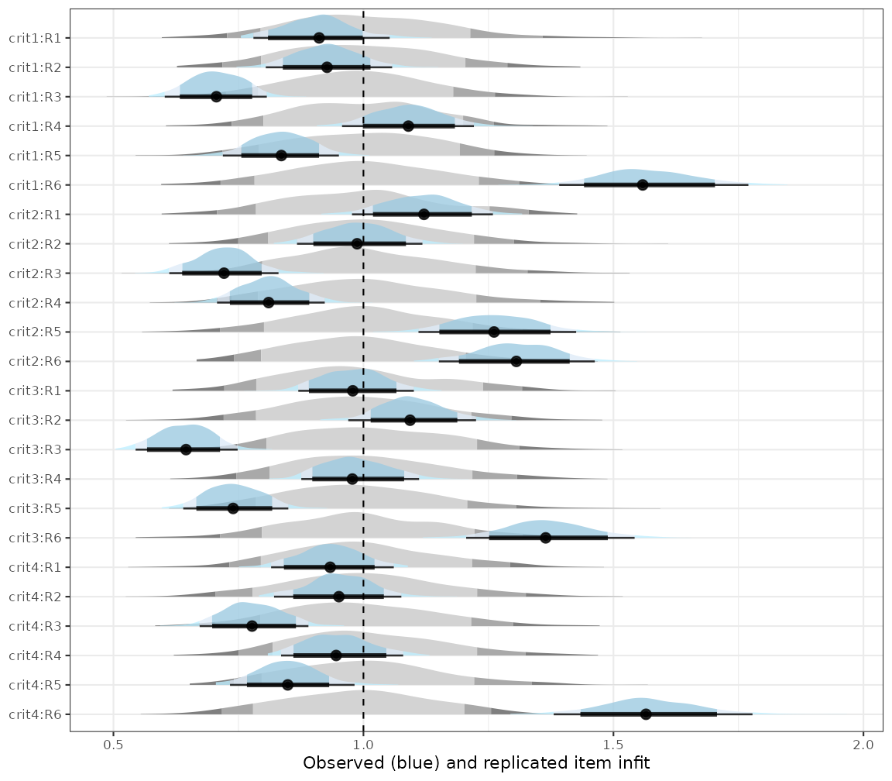
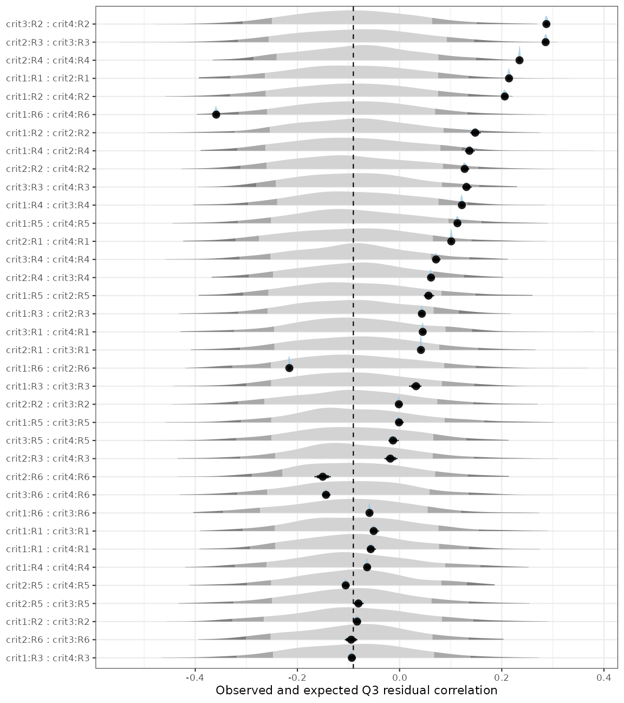
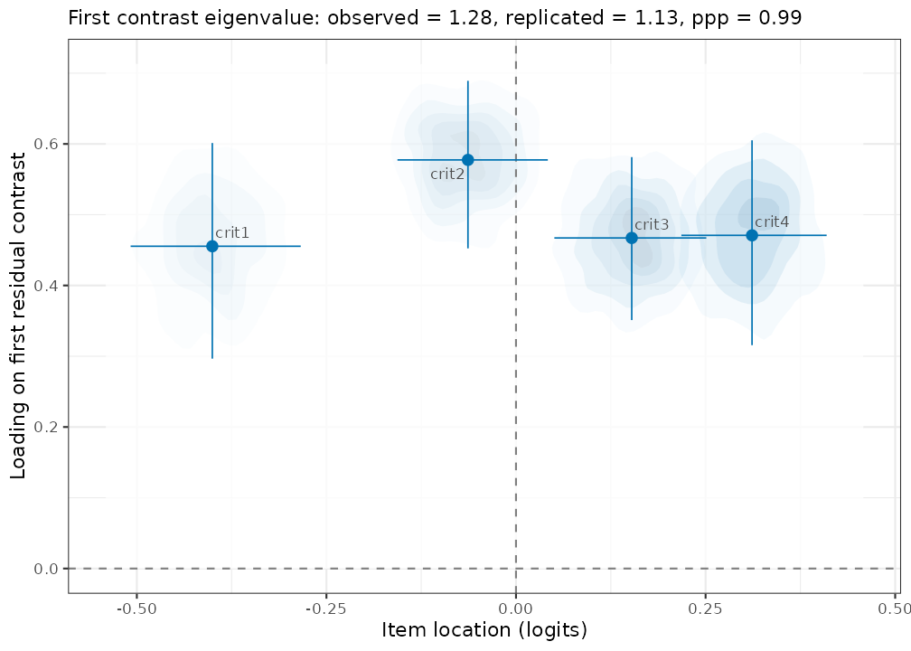

```{=html}
<style>
/* Journal-style figure captions: subtle left rule + muted colour */
.figure p.caption,
div.figure > p.caption,
figure > figcaption {
  font-size: 0.95em;
  padding-left: 0.75em;
  border-left: 3px solid #ccd;
  color: #555;
  margin-top: 0.5em;
  margin-bottom: 1.25em;
  line-height: 1.4;
}
</style>
```

## Overview

In many assessments a response is not given by the person but by a rater
who scores the person, for example examiners grading essays on several
criteria or clinicians rating patients on a structured interview. The
rating then depends on the person, the item (criterion) and the rater. The
many-facet Rasch model [@linacre_many-facet_1989; @eckes_introduction_2015]
adds the rater as a third facet, next to persons and items:

$$\text{logit} = \theta_{\text{person}} - \delta_{\text{item}} - \lambda_{\text{rater}} - \tau_k$$

where $\lambda$ is the severity of the rater and $\tau_k$ are the
thresholds of the rating scale. A severe rater gives lower ratings to
everyone, so the same person gets a different score depending on who rated
them. The model separates this from the person's location, as long as the
raters are linked through persons they have in common.

In `brms` the rater is one more term in the formula. The functions of
`easyRaschBayes` work on these models through a `facet_var` argument:

- `facet_parameters()` gives rater severity with fair averages.
- `infit_statistic()` and `item_restscore_statistic()` check the fit of
  each item x rater combination, and `infit_statistic()` pools the fit by
  rater or by item.
- `q3_statistic()` and `plot_residual_pca()` look for dependence between
  ratings, for example a halo effect.

The name `facet_var` is neutral, since the third facet can be something
other than raters, for example tasks or occasions. This vignette uses
raters throughout. It assumes the [PCM vignette](pcm-rasch-analysis.html),
where the fit statistics are explained in more detail.


``` r
library(easyRaschBayes)
library(brms)
library(dplyr)
library(tidyr)
library(tibble)
library(ggplot2)
```

## Data and rating design

The data are simulated: 150 persons rated on four criteria (`crit1` to
`crit4`) by six raters (`R1` to `R6`). Ratings have four categories,
coded 1 to 4 as the `acat` family expects. Each person was rated by three of
the six raters, so every person has 12 of the 24 item x rater combinations,
which gives 1,800 ratings. The data also hold a dichotomous version of the
same ratings, `pass`. Since the data are simulated, we know which raters
behave badly. Those departures are revealed at the end, after the
diagnostics have had their turn.


``` r
d <- readRDS("fits/mfrm_data.rds")
head(d)
#>   id  item rater rating pass
#> 1  1 crit1    R1      3    1
#> 2  1 crit2    R1      4    1
#> 3  1 crit3    R1      3    1
#> 4  1 crit4    R1      3    1
#> 5  1 crit1    R2      4    1
#> 6  1 crit2    R2      3    1
count(d, rater)
#>   rater   n
#> 1    R1 300
#> 2    R2 300
#> 3    R3 300
#> 4    R4 300
#> 5    R5 300
#> 6    R6 300
```

The rater severities can only be compared if the raters are linked by
persons they have rated in common. A design in which raters `R1` to `R3`
rate one group of persons and `R4` to `R6` another cannot tell a severe
group of raters from a group of persons with lower locations. The counts of
shared persons for each pair of raters show the links:


``` r
rater_by_person <- xtabs(~ id + rater, distinct(d, id, rater))
crossprod(rater_by_person)
#>      rater
#> rater R1 R2 R3 R4 R5 R6
#>    R1 75 25 25 50 25 25
#>    R2 25 75 25 25 50 25
#>    R3 25 25 75 25 25 50
#>    R4 50 25 25 75 25 25
#>    R5 25 50 25 25 75 25
#>    R6 25 25 50 25 25 75
```

The diagonal is the number of persons each rater rated (75), and every
pair of raters shares 25 or 50 persons, so the design is connected. The
`facet_var` functions check this, and warn if the raters or items fall
into groups that the persons do not link. That check also catches designs
in which some items are only ever scored by some raters.

## Models

We fit three rating scale models. The first adds the rater as a random
intercept to a rating scale model. The second adds a person x rater term,
`(1 | rater:id)`, which allows a rater's overall impression of a person to
carry over to all criteria for that person. This is a halo effect, a
rater's tendency to give a person similar ratings on distinct criteria
[@myford_detecting_2004]. It makes ratings by the same rater of the same
person dependent beyond what the person location explains. Wang and Wilson
[-@wang_exploring_2005] model this dependence with a random person x rater
effect, with a separate variance for each rater, and describe it as
variation in the rater's severity across persons. The third gives each
rater their own rating scale with `thres(gr = rater)`, so that raters can
differ in how they use the categories, not only in severity.


``` r
contrasts(d$item) <- contr_sum_zero(levels(d$item))

priors <- prior(normal(0, 3), class = "Intercept") +
  prior(normal(0, 1.1547), class = "b") +
  prior(exponential(1), class = "sd")

fit_rsm <- brm(
  rating ~ 1 + item + (1 | rater) + (1 | id),
  data = d, family = acat(), prior = priors,
  chains = 4, cores = 4, iter = 2000
)
fit_rsm_halo <- brm(
  rating ~ 1 + item + (1 | rater) + (1 | id) + (1 | rater:id),
  data = d, family = acat(), prior = priors,
  chains = 4, cores = 4, iter = 2000
)
fit_rsm_scales <- brm(
  rating | thres(gr = rater) ~ 1 + item + (1 | id) + (1 | rater:id),
  data = d, family = acat(), prior = priors,
  chains = 4, cores = 4, iter = 2000
)
```

The models were fitted once with `vignettes/fit-mfrm-vignette-models.R`
in the package's GitHub repository and are loaded here.


``` r
fit_rsm        <- readRDS("fits/fit_mfrm_rsm.rds")
fit_rsm_halo   <- readRDS("fits/fit_mfrm_rsm_halo.rds")
fit_rsm_scales <- readRDS("fits/fit_mfrm_rsm_scales.rds")
```

Raters are a random effect here, which suits six raters drawn from a
larger pool. With few raters, or raters of interest in themselves, the
rater can also be a fixed effect, `rating ~ 1 + item + rater + (1 | id)`.
`facet_parameters()` handles both.

### Sum-to-zero coding for the items

The four criteria are fixed effects. With an intercept, `brms` codes them
with three coefficients, by default with treatment contrasts, where the
first criterion is the reference. A prior on those coefficients is then a
prior on differences from `crit1`. Sum-to-zero coding with `contr.sum()`
looks like a remedy, but it is unbalanced. The last level is minus the sum
of the others, so a `normal(0, s)` prior on each coefficient gives the
first three criteria prior SD $s$ and the last $s\sqrt{3}$.

`contr_sum_zero()` gives orthonormal sum-to-zero contrasts, the same
coding as Stan's `sum_to_zero_vector` [@morris_sum_2025]. Every level then
gets the same prior SD, $s\sqrt{(K-1)/K}$ for $K$ levels, so
$s = \sqrt{4/3} \approx 1.15$ gives SD 1 for each of the four criteria.
Two prior-only fits of the same model, one coded each way with the same
prior on the coefficients, show the difference:


``` r
prior_sum <- readRDS("fits/prior_contr_sum.rds")
prior_ozs <- readRDS("fits/prior_contr_ozs.rds")

# Prior SD of each criterion effect: coefficients times the contrasts
level_sd <- function(fit, contr) {
  b <- as_draws_df(fit) %>%
    as_tibble() %>%
    select(starts_with("b_item")) %>%
    as.matrix()
  apply(b %*% t(contr), 2, sd)
}
crit <- levels(d$item)
rbind(
  contr.sum      = level_sd(prior_sum, contr.sum(crit)),
  contr_sum_zero = level_sd(prior_ozs, contr_sum_zero(crit))
) %>%
  round(2)
#>                crit1 crit2 crit3 crit4
#> contr.sum       1.16  1.15  1.16  2.05
#> contr_sum_zero  1.02  0.99  0.99  1.00
```

The posterior is affected little here, with 1,800 ratings, but with weak
data the coding decides which item gets the widest prior. The
`facet_var` functions and `item_parameters()` read the contrasts stored on
the factor, so any coding gives the same item and rater locations.

## Rater severity and fair averages

`facet_parameters()` reports one row per rater: the number of ratings, the
observed average rating, the fair average, and the rater's location
(severity). The location has the same sign as item difficulty, so positive
values mean a severe rater who gives lower ratings. Locations are centred
to a mean of 0 in each draw, so they do not depend on how the rater effect
is coded.


``` r
sev <- facet_parameters(fit_rsm_halo, facet_var = rater)
sev$summary
#> # A tibble: 6 × 11
#>   rater     n observed_avg fair_avg fair_avg_lower fair_avg_upper location
#>   <chr> <int>        <dbl>    <dbl>          <dbl>          <dbl>    <dbl>
#> 1 R1      300         2.85     2.85           2.72           2.98  -0.568 
#> 2 R2      300         2.51     2.53           2.41           2.66  -0.0469
#> 3 R3      300         2.54     2.51           2.38           2.63  -0.0019
#> 4 R4      300         2.45     2.47           2.34           2.60   0.0542
#> 5 R5      300         2.36     2.34           2.22           2.47   0.260 
#> 6 R6      300         2.31     2.32           2.20           2.45   0.302 
#> # ℹ 4 more variables: se <dbl>, hdci_lower <dbl>, hdci_upper <dbl>, n_eff <dbl>
sev$facet_sd
#> # A tibble: 1 × 4
#>    mean    sd hdci_lower hdci_upper
#>   <dbl> <dbl>      <dbl>      <dbl>
#> 1 0.404 0.164      0.175      0.761
```

The fair average is the expected rating each rater would give a person at
the mean location of the sample, averaged over the four criteria. It puts
the raters on the response scale. In this design all raters rate a similar
mix of persons, so the fair and observed averages are close. When raters
see different persons, for example when one rater gets all the weak
essays, they can differ a lot, and the fair average is the one to compare.

`R1` is the most lenient rater, with ratings about half a category higher
than `R6` and `R5`, the most severe. `R2`, `R3` and `R4` are in the middle
and their intervals overlap. The SD of the rater effects (`facet_sd`) is
about 0.4 logits, against about 0.9 for persons, so a person's score would
change noticeably with the rater.

With `draws = TRUE`, `facet_parameters()` also returns the location draws,
raters by draws, for `RMUreliability()`. The result says how reliably the
raters are separated by severity, so a high value means that raters differ,
which is not a sign of good rating. With six raters it is also very
uncertain.


``` r
sev_draws <- facet_parameters(fit_rsm_halo, facet_var = rater, draws = TRUE)
RMUreliability(sev_draws$draws_matrix)
#>   rmu_estimate hdci_lowerbound hdci_upperbound .width .point .interval
#> 1    0.9146404       0.7946204       0.9954878   0.95   mean      hdci
```

## Rater fit

Each item x rater combination (a cell) is treated as an item, and the
functions run as for an ordinary Rasch model, conditional on each person's
total score. A person rated by three raters has 12 cells, and the cells
they were not rated in count as missing responses.

### Infit by rater and by item

With `by = "facet"` the squared residuals and variances are summed over
all of a rater's ratings before dividing, so each rater gets one infit
value. `by = "item"` does the same for the criteria.


``` r
infit_rater <- infit_statistic(fit_rsm_halo, facet_var = rater,
                               by = "facet", ndraws_use = 500)
#> `infit_statistic()`: the model has a (1 | rater:id) term. The conditional method treats its effects as known in each draw, so the results describe fit after this dependence is accounted for. In simulations infit then flagged misfit less often than the nominal level (about 2% of fitting cells at .05 instead of 5%), so some misfit may be missed.
infit_post(infit_rater)$summary
#> # A tibble: 6 × 4
#>   rater infit_obs infit_rep infit_ppp
#>   <fct>     <dbl>     <dbl>     <dbl>
#> 1 R1        0.983     1.00      0.428
#> 2 R2        0.99      0.988     0.488
#> 3 R3        0.712     1.00      0    
#> 4 R4        0.957     0.999     0.302
#> 5 R5        0.921     1.00      0.156
#> 6 R6        1.45      1.00      1

infit_item <- infit_statistic(fit_rsm_halo, facet_var = rater,
                              by = "item", ndraws_use = 500)
#> `infit_statistic()`: the model has a (1 | rater:id) term. The conditional method treats its effects as known in each draw, so the results describe fit after this dependence is accounted for. In simulations infit then flagged misfit less often than the nominal level (about 2% of fitting cells at .05 instead of 5%), so some misfit may be missed.
infit_post(infit_item)$summary
#> # A tibble: 4 × 4
#>   item  infit_obs infit_rep infit_ppp
#>   <fct>     <dbl>     <dbl>     <dbl>
#> 1 crit1     1.01      1.00      0.556
#> 2 crit2     1.03      0.996     0.692
#> 3 crit3     0.965     0.998     0.33 
#> 4 crit4     1.00      0.996     0.538
```

Since the model has a halo term, the functions print a message. The halo
effects are treated as known in each draw, so fit is assessed after the
halo is accounted for. In simulations infit then flagged misfit less often
than the nominal level (about 2% of fitting cells at .05 instead of 5%,
see the last section). Values far from 1 are therefore clear signals, and
some misfit may be missed.

Two raters stand out. `R6` underfits, with infit around 1.4 and
`infit_ppp` 1: `R6` gives ratings that vary more than the model expects,
which is what an inconsistent rater looks like. `R3` overfits, with infit
around 0.7 and `infit_ppp` 0. `R3`'s ratings vary less than expected.
In operational data this often goes with central tendency, overuse of the
middle categories [@myford_detecting_2003; @myford_detecting_2004]. Myford
and Wolfe [-@myford_detecting_2004] also show that central tendency can give
infit above 1 when the criteria differ in difficulty, so the fit value alone
does not tell which rater effect is present. The four criteria fit, pooled
over raters.

### Infit and item-restscore by cell

The default `by = "cell"` gives one row per item x rater combination. The
output has the cell label and separate item and rater columns, which
makes it easy to filter or sort.


``` r
infit_cell <- infit_statistic(fit_rsm_halo, facet_var = rater,
                              ndraws_use = 500)
#> `infit_statistic()`: the model has a (1 | rater:id) term. The conditional method treats its effects as known in each draw, so the results describe fit after this dependence is accounted for. In simulations infit then flagged misfit less often than the nominal level (about 2% of fitting cells at .05 instead of 5%), so some misfit may be missed.
infit_cell_results <- infit_post(infit_cell)
infit_cell_results$summary %>% filter(rater %in% c("R3", "R6"))
#> # A tibble: 8 × 6
#>   cell     item  rater infit_obs infit_rep infit_ppp
#>   <fct>    <fct> <fct>     <dbl>     <dbl>     <dbl>
#> 1 crit1:R3 crit1 R3        0.706     0.985     0.026
#> 2 crit1:R6 crit1 R6        1.57      1.00      0.996
#> 3 crit2:R3 crit2 R3        0.721     0.999     0.024
#> 4 crit2:R6 crit2 R6        1.31      0.994     0.974
#> 5 crit3:R3 crit3 R3        0.644     1.01      0.006
#> 6 crit3:R6 crit3 R6        1.37      1.00      0.99 
#> 7 crit4:R3 crit4 R3        0.779     0.992     0.102
#> 8 crit4:R6 crit4 R6        1.57      0.988     1
infit_cell_results$plot
```

<div class="figure">

<p class="caption">**Figure 1.** *Infit for each item x rater combination*</p>
</div>

The pattern is consistent across criteria: all four `R6` cells underfit
and all four `R3` cells overfit. A rater problem shows up across all of
that rater's cells, while an item problem would show up across the raters
in one item's cells. Single cells of other raters are also away from 1,
for example `crit2:R5` above and `crit3:R5` below, but with no pattern
across criteria. Each cell holds only 75 ratings.

The item-restscore association gives the same picture from another angle:


``` r
rest_cell <- item_restscore_statistic(fit_rsm_halo, facet_var = rater,
                                      ndraws_use = 500)
#> `item_restscore_statistic()`: the model has a (1 | rater:id) term. The conditional method treats its effects as known in each draw, so the results describe fit after this dependence is accounted for.
item_restscore_post(rest_cell)$summary %>% arrange(ppp)
#> # A tibble: 24 × 8
#>    cell     item  rater gamma_obs gamma_exp gamma_diff   ppp p_adj
#>    <fct>    <fct> <fct>     <dbl>     <dbl>      <dbl> <dbl> <dbl>
#>  1 crit4:R6 crit4 R6        0.175     0.439     -0.264 0     0.014
#>  2 crit3:R2 crit3 R2        0.393     0.495     -0.102 0.052 0.946
#>  3 crit3:R6 crit3 R6        0.35      0.44      -0.09  0.08  0.982
#>  4 crit1:R6 crit1 R6        0.349     0.441     -0.092 0.086 0.996
#>  5 crit2:R1 crit2 R1        0.482     0.525     -0.042 0.22  1    
#>  6 crit2:R6 crit2 R6        0.4       0.441     -0.041 0.224 1    
#>  7 crit3:R3 crit3 R3        0.386     0.412     -0.026 0.282 1    
#>  8 crit1:R4 crit1 R4        0.458     0.473     -0.015 0.318 1    
#>  9 crit2:R5 crit2 R5        0.48      0.503     -0.024 0.328 1    
#> 10 crit3:R4 crit3 R4        0.466     0.477     -0.011 0.344 1    
#> # ℹ 14 more rows
```

The `R6` cells have the weakest association with the rest score, and for
`crit4` it is far below the expected value (`gamma_obs` 0.18 against
0.44). The other cells are close to their expected values after
adjustment for the 24 cells (`p_adj`).

## Halo: dependence between ratings by the same rater

A halo effect makes a rater's ratings of the same person on different
criteria more similar than the person location explains. Without a halo
term in the model, this shows as positive residual correlations between
cells that share the rater. `q3_statistic()` with `facet_var` computes Q3
for every pair of cells that some person has in common, and the
`pair_type` column says whether the two cells share the rater (`"same
rater"`), the item (`"same item"`), or neither.


``` r
q3_rsm <- q3_statistic(fit_rsm, facet_var = rater, ndraws_use = 500)
q3_rsm_results <- q3_post(q3_rsm)

q3_rsm_results$summary %>%
  group_by(pair_type) %>%
  summarise(pairs = n(), q3_obs = mean(q3_obs), q3_rep = mean(q3_rep),
            q3_diff = mean(q3_diff))
#> # A tibble: 3 × 5
#>   pair_type  pairs  q3_obs  q3_rep q3_diff
#>   <chr>      <int>   <dbl>   <dbl>   <dbl>
#> 1 neither      180 -0.133  -0.0882 -0.0448
#> 2 same item     60 -0.124  -0.0924 -0.0322
#> 3 same rater    36  0.0243 -0.0905  0.115
```

Without the halo term, the same-rater pairs have a mean observed Q3 of
about 0.02, against about -0.09 in replicated data. The other pair types
are slightly below their replicated values, which is expected, since
residuals given the total score sum to zero, and a positive dependence in
some pairs is offset by negative values elsewhere. With the halo term the
difference disappears:


``` r
q3_halo <- q3_statistic(fit_rsm_halo, facet_var = rater, ndraws_use = 500)
#> `q3_statistic()`: the model has a (1 | rater:id) term. The conditional method treats its effects as known in each draw, so the results describe fit after this dependence is accounted for.
q3_halo_results <- q3_post(q3_halo)

q3_halo_results$summary %>%
  group_by(pair_type) %>%
  summarise(pairs = n(), q3_obs = mean(q3_obs), q3_rep = mean(q3_rep),
            q3_diff = mean(q3_diff))
#> # A tibble: 3 × 5
#>   pair_type  pairs  q3_obs  q3_rep  q3_diff
#>   <chr>      <int>   <dbl>   <dbl>    <dbl>
#> 1 neither      180 -0.0954 -0.0884 -0.00697
#> 2 same item     60 -0.0849 -0.0901  0.00518
#> 3 same rater    36 -0.0808 -0.0918  0.0111
```

Read the halo from the mean of the same-rater pairs rather than from
single pairs. Single pairs are noisy: there are 276 pairs, most of them
shared by only 25 persons, and in simulations the adjusted p-value
`q3_p_adj` rarely flagged a halo of this size (see the last section).
Sorted by the size of the difference, the top of `q3_rsm_results$summary`
is a mix of pair types with large positive and negative values. Plotting
only the same-rater pairs shows the halo:


``` r
q3_rsm %>%
  filter(pair_type == "same rater") %>%
  q3_post() %>%
  .$plot
```

<div class="figure">

<p class="caption">**Figure 2.** *Q3 for the 36 same-rater pairs, model without halo term*</p>
</div>

Most observed values (points) lie to the right of the centre of their
replicated distributions, which is the overall shift seen in the means.
The pairs of `R6` are the exception. `R6` rates inconsistently, so the
residuals of `R6`'s ratings share less with each other.

Positive Q3 in one rater's same-rater pairs is not specific to a halo. In
simulations, a rater with central tendency had it too, and so did the
raters who shared persons with an inconsistent rater, while the
inconsistent rater did not. Rater infit tells these cases apart, as
described in the last section.

The residual PCA looks for the same thing in another way. With
`facet_var`, each person x rater combination is one row of the residual
matrix, so a halo shows as a first component on which all criteria load in
the same direction.


``` r
pca_rsm <- plot_residual_pca(fit_rsm, facet_var = rater, ndraws_use = 500)
pca_rsm$eigenvalue
#> # A tibble: 1 × 6
#>   eigenvalue_obs eigenvalue_rep eigenvalue_diff   ppp var_explained_obs
#>            <dbl>          <dbl>           <dbl> <dbl>             <dbl>
#> 1           1.28           1.13           0.150  0.99             0.316
#> # ℹ 1 more variable: var_explained_rep <dbl>
pca_rsm$plot
```

<div class="figure">

<p class="caption">**Figure 3.** *Loadings on the first residual contrast, model without halo term*</p>
</div>

``` r

pca_halo <- plot_residual_pca(fit_rsm_halo, facet_var = rater,
                              ndraws_use = 500)
pca_halo$eigenvalue
#> # A tibble: 1 × 6
#>   eigenvalue_obs eigenvalue_rep eigenvalue_diff   ppp var_explained_obs
#>            <dbl>          <dbl>           <dbl> <dbl>             <dbl>
#> 1           1.14           1.13         0.00776 0.544             0.281
#> # ℹ 1 more variable: var_explained_rep <dbl>
```

Without the halo term, the first observed eigenvalue is larger than the
replicated one in nearly all draws, and all four criteria load positively
on the first contrast, which is the halo pattern. With the halo term the
observed and replicated eigenvalues are the same. The model comparison agrees, with a clear advantage for the halo
model, and the halo SD is estimated at about 0.5 logits:


``` r
loo_compare(loo(fit_rsm), loo(fit_rsm_halo))
#>         model elpd_diff se_diff p_worse diag_diff diag_elpd
#>  fit_rsm_halo       0.0     0.0      NA                    
#>       fit_rsm     -23.7     7.1    1.00
VarCorr(fit_rsm_halo)$`rater:id`$sd
#>            Estimate  Est.Error     Q2.5    Q97.5
#> Intercept 0.5074118 0.07118334 0.367036 0.645209
```

The halo term also matters for the rater severities. In simulations,
fitting a model without it to data with a halo gave intervals for the
severities that were too narrow (see the last section).

## Rater-specific rating scales

`R3` overfitted in the rating scale model. One explanation is that `R3`
uses the categories differently from the other raters. `thres(gr = rater)`
gives each rater their own thresholds. The rater's location is then the
mean of their thresholds, and `facet_parameters()` adds a table of the
thresholds. brms sets the number of each rater's thresholds from the
categories that rater used. Here every rater used all four, but if a rater
never gives the top category, set the number in the formula, as in
`thres(3, gr = rater)`, or `facet_parameters()` stops.


``` r
sev_scales <- facet_parameters(fit_rsm_scales, facet_var = rater)
sev_scales$summary
#> # A tibble: 6 × 11
#>   rater     n observed_avg fair_avg fair_avg_lower fair_avg_upper location
#>   <chr> <int>        <dbl>    <dbl>          <dbl>          <dbl>    <dbl>
#> 1 R1      300         2.85     2.90           2.78           3.03  -0.568 
#> 2 R2      300         2.51     2.51           2.36           2.64  -0.105 
#> 3 R3      300         2.54     2.52           2.42           2.61  -0.0014
#> 4 R4      300         2.45     2.49           2.35           2.63   0.0723
#> 5 R5      300         2.36     2.32           2.19           2.47   0.293 
#> 6 R6      300         2.31     2.29           2.15           2.44   0.310 
#> # ℹ 4 more variables: se <dbl>, hdci_lower <dbl>, hdci_upper <dbl>, n_eff <dbl>
sev_scales$thresholds %>%
  select(rater, threshold, location) %>%
  pivot_wider(names_from = threshold, names_prefix = "tau_",
              values_from = location) %>%
  mutate(spread = tau_3 - tau_1)
#> # A tibble: 6 × 5
#>   rater  tau_1   tau_2 tau_3 spread
#>   <chr>  <dbl>   <dbl> <dbl>  <dbl>
#> 1 R1    -1.76  -0.722  0.780   2.54
#> 2 R2    -1.63   0.306  1.01    2.64
#> 3 R3    -2.32  -0.0409 2.35    4.67
#> 4 R4    -1.11  -0.0963 1.43    2.54
#> 5 R5    -1.17   0.323  1.73    2.89
#> 6 R6    -0.871  0.329  1.47    2.34
```

The first and third thresholds of `R3` are about 4.7 logits apart, against
2.3 to 2.9 logits for the other raters. Widely spaced thresholds mean that the
middle categories cover more of the latent variable, so `R3` gives the
middle categories more often and the extreme ones less often: central
tendency. With a rating scale of their own, `R3` fits:


``` r
infit_scales <- infit_statistic(fit_rsm_scales, facet_var = rater,
                                by = "facet", ndraws_use = 500)
#> `infit_statistic()`: the model has a (1 | rater:id) term. The conditional method treats its effects as known in each draw, so the results describe fit after this dependence is accounted for. In simulations infit then flagged misfit less often than the nominal level (about 2% of fitting cells at .05 instead of 5%), so some misfit may be missed.
infit_post(infit_scales)$summary
#> # A tibble: 6 × 4
#>   rater infit_obs infit_rep infit_ppp
#>   <fct>     <dbl>     <dbl>     <dbl>
#> 1 R1        0.943     1.00      0.266
#> 2 R2        0.955     1.01      0.294
#> 3 R3        0.948     1.00      0.292
#> 4 R4        0.898     1.00      0.118
#> 5 R5        0.929     0.999     0.224
#> 6 R6        1.36      1.00      1
```

`R6` still underfits, since inconsistency is not a matter of how the
categories are used. In simulations, a model with rater-specific
thresholds flagged a rater in about 1% of datasets, by infit or by Q3,
when the raters did not differ. With a central-tendency rater in the
data, the flags for that rater disappeared, and the rater's thresholds
showed the wider spacing (see the last section). Rater-specific scales are a way to describe how
raters differ, not a remedy. A rater with central tendency loses
information about the persons, which shows as less spread in their
ratings, and whether that rater should be retrained or their ratings
weighted differently is a decision outside the model.

## Dichotomous ratings

For pass/fail ratings the model is the same with the `bernoulli()` family,
and the functions work in the same way:


``` r
fit_rm_halo <- brm(
  pass ~ 1 + item + (1 | rater) + (1 | id) + (1 | rater:id),
  data = d, family = bernoulli(), prior = priors,
  chains = 4, cores = 4, iter = 2000
)
```


``` r
fit_rm_halo <- readRDS("fits/fit_mfrm_rm_halo.rds")
facet_parameters(fit_rm_halo, facet_var = rater)$summary
#> # A tibble: 6 × 11
#>   rater     n observed_avg fair_avg fair_avg_lower fair_avg_upper location    se
#>   <chr> <int>        <dbl>    <dbl>          <dbl>          <dbl>    <dbl> <dbl>
#> 1 R1      300        0.663    0.669          0.605          0.74   -0.452  0.145
#> 2 R2      300        0.607    0.64           0.569          0.702  -0.319  0.138
#> 3 R3      300        0.58     0.584          0.518          0.654  -0.0772 0.132
#> 4 R4      300        0.53     0.539          0.473          0.614   0.111  0.136
#> 5 R5      300        0.517    0.527          0.454          0.594   0.164  0.135
#> 6 R6      300        0.417    0.428          0.354          0.5     0.572  0.144
#> # ℹ 3 more variables: hdci_lower <dbl>, hdci_upper <dbl>, n_eff <dbl>
infit_rm <- infit_statistic(fit_rm_halo, facet_var = rater, by = "facet",
                            ndraws_use = 500)
#> `infit_statistic()`: the model has a (1 | rater:id) term. The conditional method treats its effects as known in each draw, so the results describe fit after this dependence is accounted for. In simulations infit then flagged misfit less often than the nominal level (about 2% of fitting cells at .05 instead of 5%), so some misfit may be missed.
infit_post(infit_rm)$summary
#> # A tibble: 6 × 4
#>   rater infit_obs infit_rep infit_ppp
#>   <fct>     <dbl>     <dbl>     <dbl>
#> 1 R1        0.97      1.00      0.326
#> 2 R2        1.01      1         0.588
#> 3 R3        0.973     1         0.31 
#> 4 R4        0.96      0.998     0.246
#> 5 R5        0.963     0.996     0.28 
#> 6 R6        1.15      1         0.988
```

The fair average is now the expected proportion of passes. The ordering of
the raters is similar to the polytomous model, and `R6` underfits, less
clearly than before. Two categories hold less information than four, and
central tendency has no meaning with two categories, so `R3` fits here.

## What was built into the data

The data were simulated with these departures from the rating scale model:

- Rater severities -0.6, -0.2, 0, 0.1, 0.3 and 0.4 logits (`R1` to `R6`).
- `R6` rates inconsistently, with a discrimination of 0.4 instead of 1.
- `R3` has thresholds -2.6, 0 and 2.6 instead of -1.5, 0 and 1.5, which
  gives central tendency.
- A halo effect for all raters, with SD 0.6 logits.


``` r
truth <- readRDS("fits/mfrm_truth.rds")
tibble(
  rater    = names(truth$severity),
  true     = truth$severity - mean(truth$severity),
  estimate = sev$summary$location,
  lower    = sev$summary$hdci_lower,
  upper    = sev$summary$hdci_upper
) %>%
  mutate(across(-rater, ~ round(.x, 2)))
#> # A tibble: 6 × 5
#>   rater  true estimate lower upper
#>   <chr> <dbl>    <dbl> <dbl> <dbl>
#> 1 R1     -0.6    -0.57 -0.76 -0.35
#> 2 R2     -0.2    -0.05 -0.22  0.14
#> 3 R3      0       0    -0.2   0.18
#> 4 R4      0.1     0.05 -0.13  0.24
#> 5 R5      0.3     0.26  0.08  0.45
#> 6 R6      0.4     0.3   0.12  0.5
```

The diagnostics found each of them: `R6` through infit and item-restscore,
`R3` through overfit and its threshold spacing, the halo through Q3 for
same-rater pairs, the residual PCA and the model comparison. The true
severities are inside their intervals from the halo model. The largest
gap is for `R6`, the inconsistent rater (0.30 against 0.40).

## How well the checks work

The statistics were checked in a simulation with the model true, with
dichotomous and rating scale models, 300 and 600 persons, 5 items and 8
raters, each person rated by two raters (10 of 40 cells), and 200
replications per condition. The script is `dev/null_mfrm_calibration.R`
in the package's GitHub repository. Under a true model, a two-sided p-value below .05
should occur for 5% of the cells.

- Item-restscore was calibrated, with 4% to 5% of cells flagged at .05,
  with or without a halo term in the model.
- Infit flagged 4% to 5% of cells without a halo term, and 2% with one.
  Pooled by rater it flagged 1% to 3%. With the halo term in the model,
  infit therefore misses some misfit.
- Q3 flagged 4% to 5% of pairs without a halo term, and 3% to 4% with one.
- The adjusted p-values (`p_adj`, `q3_p_adj`) kept the probability of
  any false flag in a dataset at or below about .05.
- With a halo in the data but not in the model, the mean Q3 of same-rater
  pairs was clearly above the replicated value, but `q3_p_adj` flagged
  single pairs in only 4% to 64% of datasets, depending on the model and
  sample size. Infit and item-restscore did not react to the halo.
- Rater severity intervals covered the true value in 91% to 95% of cases
  when the model matched the data, and in 81% to 90% when a halo in the
  data was not modelled.

So include the halo term when raters score several criteria for each
person, and read the halo from the mean Q3 of same-rater pairs, the
residual PCA and a model comparison rather than from single pairs.

### Which rater effect a flag points to

A second simulation asked which check reacts to which rater effect. It
used 300 persons, 5 items and 8 raters, with each person rated by two
neighbouring raters, so that each rater shares persons with two others.
The data had one of two kinds of rater effects, which the fitted model
did not include:

- One inconsistent rater, with a discrimination of 0.4 instead of 1. In
  the rating scale model also one rater with central tendency, whose
  thresholds were 1.8 times as far apart as those of the other raters.
- A halo with SD 0.6 logits for two of the eight raters.

The rating scale model was fitted with common thresholds and with
`thres(gr = rater)`. There were 100 replications per condition. Infit was
computed with `by = "facet"`. For Q3, the mean of each rater's 10
same-rater pairs was compared with its replicated values, with p-values
adjusted over the raters as for `p_adj`. This per-rater test is not in
the package. Averaging `q3_diff` over each rater's same-rater pairs in the
`q3_post()` summary gives the same view without the p-value. The scripts
are `dev/halo_test_quick.R` and `dev/halo_followup.R` in the GitHub
repository.

The table shows the percentage of datasets in which a rater was flagged
(`p_adj` < .05), for the rating scale model with common thresholds and,
in parentheses, the dichotomous model. With thresholds by rater, the
values for the inconsistent and the halo raters were within one
percentage point of these.

| Rater effect | Infit of the rater | Same-rater Q3 of the rater | Same-rater Q3 of raters sharing persons with it |
|:--|:--|:--|:--|
| Inconsistent | underfit, 100% (73%) | 0% (2%) | 13% (4%) |
| Central tendency, common thresholds | overfit, 90% | 16% | 0% |
| Central tendency, thresholds by rater | 0% | 1% | 0% |
| Halo | 0% (0%) | 46% (8%) | 9% (2%) |

So the checks point to different rater effects:

- Infit above 1 (underfit) points to an inconsistent rater. Q3 does not
  flag this rater, but it can flag the raters who rate the same persons.
  The inconsistent ratings enter those persons' total scores, so the
  other rater's ratings of them presumably depart from what the total
  predicts in the same direction.
- Infit below 1 (overfit) points to central tendency. With
  `thres(gr = rater)` the rater's first and third thresholds were 4.2
  logits apart against 2.2 to 2.4 for the other raters (generating values
  4.3 and 2.4), and the flags went away.
- Positive same-rater Q3 without an infit flag points to a halo, or to a
  rater who shares persons with an inconsistent rater. If one of those
  other raters underfits, the second reading is the more likely one.
- A halo in a single rater was flagged in about half of the datasets with
  300 persons and four categories, and rarely with dichotomous ratings.
  No Q3 flag therefore does not rule out a halo.

These results come from one rating design. In the example data every
pair of raters shares persons, so the effect of an inconsistent rater on
the other raters' Q3 may be spread over all of them.

## References
