```{=html}
<style>
/* Journal-style figure captions: subtle left rule + muted colour */
.figure p.caption,
div.figure > p.caption,
figure > figcaption {
  font-size: 0.95em;
  padding-left: 0.75em;
  border-left: 3px solid #ccd;
  color: #555;
  margin-top: 0.5em;
  margin-bottom: 1.25em;
  line-height: 1.4;
}
</style>
```

## Overview

This vignette shows a Rasch analysis of a polytomous questionnaire with
`easyRaschBayes`, using the partial credit model (PCM) fitted with `brms`.
The data are the PHQ-9 depression screener, included in the package as
`phq9`.

The functions work with Bayesian Rasch models fitted with `brms`: the
partial credit model (`acat` family with `thres(gr = item)`), the rating
scale model, the dichotomous Rasch model (`bernoulli` family), and a hurdle
partial credit model for data with many zero responses (see the
[hurdle PCM vignette](hpcm-rasch-analysis.html)). A code example for the
dichotomous model is available
[here](https://pgmj.github.io/reliability.html#rasch-dichotomous-model),
and more detail on Rasch models in `brms` is in @burkner_bayesian_2021.

The frequentist counterpart is
[`easyRasch2`](https://pgmj.github.io/easyRasch2/), which uses conditional
maximum likelihood and simulation-based critical values. Its
[Get Started vignette](https://pgmj.github.io/easyRasch2/articles/easyRasch2.html)
analyses the same `phq9` data, so the two can be read side by side.
Several functions here follow their `easyRasch2` counterparts, for example
`plot_icc()` (`RMitemICCPlot()`) and `plot_targeting()` (`RMtargeting()`).
Each function has documentation and example code, see `?function_name`.

The sections follow the four requirements of a Rasch model
[@christensen_rasch_2013; @christensen_psychometric_2021]:

1. **Unidimensionality** --- the items measure a single latent variable.
2. **Local independence** --- given the latent variable, item responses
   are independent of each other.
3. **Ordered response categories** --- moving up the latent variable
   increases the probability of higher categories.
4. **Invariance (no differential item functioning)** --- item parameters
   are the same across relevant groups, here gender.

They are followed by descriptors that are usually reported alongside the
four requirements:

- Targeting --- how well person and item locations overlap on the latent
  variable.
- Reliability --- how precisely the scale separates respondents.
- Item and person parameters --- item thresholds, person locations, and a
  table from sum score to person location.


``` r
library(easyRaschBayes)
library(brms)
library(dplyr)
library(tidyr)
library(tibble)
library(ggplot2)
```

## Data

`phq9` holds 600 respondents to the PHQ-9 [@kroenke_phq9_2001] in the U.S. National Health and
Nutrition Examination Survey (NHANES, September 2024 release), with
complete responses on all nine items. Respondents with a sum score of zero
were reduced by hand, so symptom levels are much higher than in the NHANES
population. See `?phq9`, and the `phq9_nhanes` data for a random sample.
Each item is scored 0 ("Not at all"), 1 ("Several days"), 2 ("More than
half the days") and 3 ("Nearly every day").


``` r
data(phq9)
items <- phq9[, 1:9]

item_desc <- c(
  q1 = "Little interest or pleasure in doing things",
  q2 = "Feeling down, depressed, or hopeless",
  q3 = "Trouble falling or staying asleep, or sleeping too much",
  q4 = "Feeling tired or having little energy",
  q5 = "Poor appetite or overeating",
  q6 = "Feeling bad about yourself, or that you are a failure",
  q7 = "Trouble concentrating on things",
  q8 = "Moving or speaking slowly, or being fidgety or restless",
  q9 = "Thoughts that you would be better off dead, or of hurting yourself"
)
resp_labels <- c("Not at all", "Several days", "More than half the days",
                 "Nearly every day")

summary(rowSums(items))
#>    Min. 1st Qu.  Median    Mean 3rd Qu.    Max. 
#>    0.00   10.00   16.00   15.41   21.00   27.00
table(phq9$gender, useNA = "ifany")
#> 
#> Female   Male   <NA> 
#>    426    143     31
```


|item |description                                                        |
|:----|:------------------------------------------------------------------|
|q1   |Little interest or pleasure in doing things                        |
|q2   |Feeling down, depressed, or hopeless                               |
|q3   |Trouble falling or staying asleep, or sleeping too much            |
|q4   |Feeling tired or having little energy                              |
|q5   |Poor appetite or overeating                                        |
|q6   |Feeling bad about yourself, or that you are a failure              |
|q7   |Trouble concentrating on things                                    |
|q8   |Moving or speaking slowly, or being fidgety or restless            |
|q9   |Thoughts that you would be better off dead, or of hurting yourself |


### Descriptive plots

Before fitting a model it is good to look at the response distributions.
The plotting functions take wide data, one column per item.


``` r
plot_stackedbars(items)
```

<div class="figure">
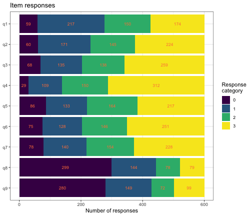
<p class="caption">**Figure 1.** *Response distribution per item*</p>
</div>

`plot_tile()` and `plot_bars()` show the same data in other forms.

### Long format

`brms` needs long data, one row per person and item. The `acat` family
expects response categories starting at 1, so we add 1 to every response.
The functions in this package score the responses from 0 again in their
output.


``` r
df_pcm <- phq9 %>%
  rownames_to_column("id") %>%
  select(id, gender, starts_with("q")) %>%
  pivot_longer(starts_with("q"), names_to = "item",
               values_to = "response") %>%
  mutate(response = response + 1)

head(df_pcm)
#> # A tibble: 6 × 4
#>   id    gender item  response
#>   <chr> <fct>  <chr>    <dbl>
#> 1 1     Female q1           4
#> 2 1     Female q2           4
#> 3 1     Female q3           4
#> 4 1     Female q4           4
#> 5 1     Female q5           4
#> 6 1     Female q6           4
```

## Fitting the PCM

The model is fitted once and saved. The chunk below shows the call, which
is not run when the vignette is built. The saved model is loaded instead.


``` r
prior_pcm <- prior("normal(0, 3)", class = "Intercept") +
  prior("normal(0, 3)", class = "sd", group = "id")
```


``` r
fit_pcm <- brm(
  response | thres(gr = item) ~ 1 + (1 | id),
  data   = df_pcm,
  family = acat,
  prior  = prior_pcm,
  chains = 4, cores = 4, iter = 2000
)
saveRDS(fit_pcm, "fits/fit_pcm_phq9.rds")
```


``` r
fit_pcm <- readRDS("fits/fit_pcm_phq9.rds")
```

`thres(gr = item)` gives each item its own thresholds, which makes this a
partial credit model. `(1 | id)` is the person location.

For a rating scale model, where all items share the same distances between
thresholds and differ only in location, drop `thres(gr = item)` and add an
item effect instead. The thresholds are then common to all items, and each
item's location is shifted by its coefficient:

```r
fit_rsm <- brm(
  response ~ 1 + item + (1 | id),
  data   = df_pcm,
  family = acat,
  prior  = prior("normal(0, 3)", class = "Intercept") +
    prior("normal(0, 3)", class = "b") +
    prior("normal(0, 3)", class = "sd", group = "id"),
  chains = 4, cores = 4, iter = 2000
)
```

The functions in this package accept this model in the same way.
`loo_compare()` can then be used to compare it with the partial credit
model.

## 1. Unidimensionality

### Item fit: conditional infit

`infit_statistic()` computes infit (and optionally outfit, see @muller_item_2020) mean squares
for each item, conditional on each person's total score, as in
`iarm::out_infit()`. For the same item parameters the observed values are
the same as iarm's. The function compares them with data replicated from
the model, also conditional on the total score.

The `ndraws_use` argument limits the number of posterior draws used, which
makes exploration faster. For final results, use all draws
(`ndraws_use = NULL`, the default).


``` r
fit_stats <- infit_statistic(fit_pcm, ndraws_use = 500)

infit_results <- infit_post(fit_stats)
infit_results$summary
#> # A tibble: 9 × 4
#>   item  infit_obs infit_rep infit_ppp
#>   <chr>     <dbl>     <dbl>     <dbl>
#> 1 q1        0.95      1.00      0.162
#> 2 q2        0.784     0.998     0    
#> 3 q3        1.24      1         1    
#> 4 q4        0.833     1         0.01 
#> 5 q5        1.08      0.999     0.88 
#> 6 q6        0.904     1.00      0.056
#> 7 q7        0.995     1         0.48 
#> 8 q8        1.27      1.00      0.998
#> 9 q9        1.33      1.00      1
infit_results$plot
```

<div class="figure">
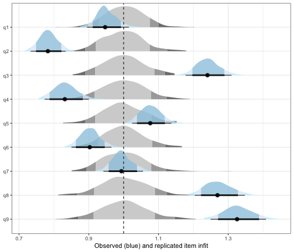
<p class="caption">**Figure 2.** *Observed and replicated infit*</p>
</div>

`infit_obs` is the observed infit and `infit_rep` the infit of replicated
data. Values above 1 mean more variation in the responses than the model
expects (underfit), which can indicate multidimensionality. Values below 1
mean less (overfit), which can come with local dependence. `infit_ppp` is
the proportion of posterior draws where the observed infit exceeds the
replicated one. Values near 0.5 indicate good fit, values near 1 underfit,
and values near 0 overfit.

The ppp is conservative, because the item parameters are estimated from
the same data. In simulations under a fitting model it rarely came close to
0 or 1, so misfit can go undetected. We therefore also use the
item-restscore association below, whose ppp was close to uniform in the
same simulations. The ppp is not a measure of the size of misfit.

Three items underfit: `q9` (thoughts of self-harm, infit about 1.33),
`q8` (moving slowly or restless, 1.27) and `q3` (sleep, 1.24), all with
`infit_ppp` near 1. Two overfit: `q2` (feeling down, 0.78) and `q4`
(feeling tired, 0.83). Given how conservative the ppp is, values this close
to 0 or 1 are clear signals, but they should not be read item by item.
Infit is relative to the other items. An item in a strongly dependent pair
usually overfits, and that makes the remaining items look more underfit
than they would otherwise. `q2` is part of the strongest dependent pair
(see local dependence below), so fit should be checked again after the
dependence is dealt with, for example by removing one item of the pair.

### Item-restscore association

`item_restscore_statistic()` computes Goodman-Kruskal's gamma between each
item and the rest score (the total score minus the item), and compares it
with the gamma expected under the model given the total scores
[@kreiner_note_2011]. The expected value differs between items, since it depends on item
locations and targeting. An observed gamma above the expected value means
the item discriminates more than the model implies, and below it less.
`ppp` is a posterior predictive p-value from data replicated conditional on
each person's total score. Values near 1 mean a stronger association than
expected, and near 0 a weaker one. `p_adj` is two-sided and adjusted for
the number of items, so small values flag a departure in either direction.


``` r
rest_stats <- item_restscore_statistic(fit_pcm, ndraws_use = 500)

rest_results <- item_restscore_post(rest_stats)
rest_results$summary
#> # A tibble: 9 × 6
#>   item  gamma_obs gamma_exp gamma_diff   ppp p_adj
#>   <chr>     <dbl>     <dbl>      <dbl> <dbl> <dbl>
#> 1 q1        0.658     0.62       0.039 0.938 0.7  
#> 2 q2        0.725     0.624      0.101 1     0    
#> 3 q3        0.569     0.629     -0.06  0     0.048
#> 4 q4        0.712     0.617      0.095 1     0    
#> 5 q5        0.62      0.623     -0.003 0.392 1    
#> 6 q6        0.69      0.627      0.063 0.992 0.058
#> 7 q7        0.642     0.624      0.019 0.774 0.996
#> 8 q8        0.55      0.635     -0.085 0     0    
#> 9 q9        0.59      0.638     -0.048 0.02  0.25
rest_results$plot
```

<div class="figure">
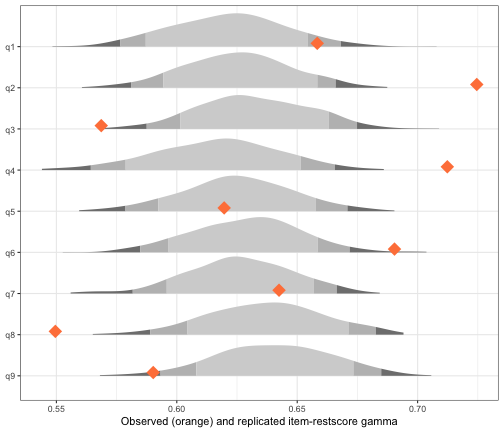
<p class="caption">**Figure 3.** *Observed and expected item-restscore gamma*</p>
</div>

Item-restscore agrees with infit for four of the five items. `q2` and
`q4` have a stronger association with the rest score than expected
(`p_adj` near 0), and `q8` and `q3` a weaker one. `q9` has a weaker
association than expected as well (`ppp` 0.02), but after adjustment for
the number of items it is not flagged (`p_adj` 0.25). `q6` leans towards
overfit (`ppp` 0.99, `p_adj` 0.06).

### Conditional item characteristic curves

`plot_icc()` compares the model-expected item score with the observed mean
item score in class intervals of the total score. Persons with the minimum
or maximum total score are left out. By default the respondents are split
into `class_intervals = 5` groups of about equal size
(`method = "quantile"`). Other options are equal-width groups (`"width"`),
one group per total score (`"score"`), or groups set by hand (`"manual"`
with `score_breaks`). Tied total scores can give fewer quantile groups than
requested, and the caption states the grouping that was used.


``` r
plot_icc(fit_pcm)
```

<div class="figure">
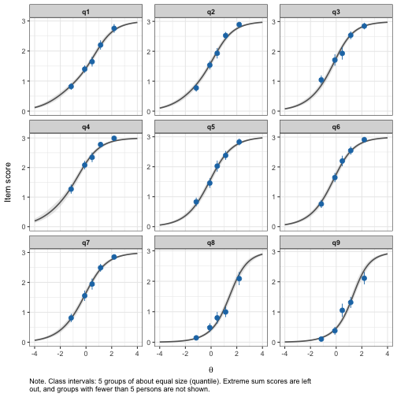
<p class="caption">**Figure 4.** *Conditional item characteristic curves*</p>
</div>

The curves show the same items. The observed points of `q8` and `q9` are
flatter than the model curve, above it in the middle and below it at the
top, which is what underfit looks like. `q2` and `q4` are slightly steeper
than the curve.

### Residual PCA

`plot_residual_pca()` runs a principal components analysis of the
person-item residuals and plots the loadings on the first residual
contrast against the item locations, with the uncertainty of both.


``` r
pca <- plot_residual_pca(fit_pcm, ndraws_use = 500)
pca$eigenvalue
#> # A tibble: 1 × 6
#>   eigenvalue_obs eigenvalue_rep eigenvalue_diff   ppp var_explained_obs
#>            <dbl>          <dbl>           <dbl> <dbl>             <dbl>
#> 1           1.66           1.24           0.424     1             0.181
#> # ℹ 1 more variable: var_explained_rep <dbl>
pca$plot
```

<div class="figure">
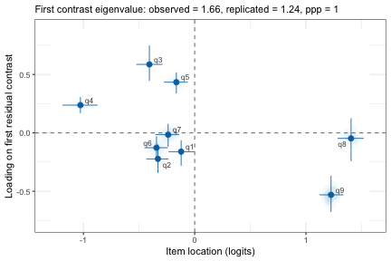
<p class="caption">**Figure 5.** *Loadings on the first residual contrast and item locations*</p>
</div>

`ppp` in `pca$eigenvalue` is the proportion of draws where the observed
largest eigenvalue exceeds the replicated one. Values near 1 suggest more
structure in the residuals than the model implies. Items with loadings of
opposite sign on the first contrast are candidates for a second dimension.

The observed first eigenvalue (1.66) is larger than the replicated one
(1.24) in every draw. The loadings separate `q3`, `q5` and `q4` (sleep,
appetite and tiredness) from `q9`, `q2`, `q6` and `q1` (self-harm
thoughts, feeling down, feeling bad about yourself and little interest).
The somatic items share something the model does not capture, and so do
the mood items.

## 2. Local independence

`q3_statistic()` computes Yen's Q3 [@yen_scaling_1984], the correlation between the residuals
of each pair of items. Given the latent variable, residuals should be
uncorrelated, and pairs with higher correlations than the model replicates
suggest local dependence [@levy_posterior_2009]. As for infit and
item-restscore, the residuals are taken from the expected responses given
each person's total score. Given the total score, a person's residuals
sum to zero, so Q3 centres on about $-1/(k-1)$, here $-0.125$, rather
than on 0 [@christensen2017]. The replicated values have the
same centre, so `q3_diff` (observed minus replicated) is the quantity to
read. `q3_ppp` near 1 flags a pair, and `q3_p_adj` adjusts for the 36
pairs, with small values flagging a pair. The dashed line in the plot is
the mean replicated Q3.


``` r
q3_stats <- q3_statistic(fit_pcm, ndraws_use = 500)

q3_results <- q3_post(q3_stats)
q3_results$summary
#> # A tibble: 36 × 8
#>    item_pair item_1 item_2 q3_obs q3_rep q3_diff q3_ppp q3_p_adj
#>    <chr>     <chr>  <chr>   <dbl>  <dbl>   <dbl>  <dbl>    <dbl>
#>  1 q1 : q2   q1     q2      0.239 -0.121   0.361  1        0    
#>  2 q3 : q5   q3     q5      0.075 -0.139   0.214  1        0    
#>  3 q3 : q4   q3     q4      0.062 -0.128   0.19   1        0    
#>  4 q7 : q8   q7     q8      0.066 -0.115   0.181  1        0    
#>  5 q2 : q9   q2     q9      0.049 -0.123   0.171  1        0    
#>  6 q2 : q6   q2     q6      0.016 -0.132   0.148  1        0.006
#>  7 q4 : q5   q4     q5     -0.01  -0.123   0.113  0.996    0.11 
#>  8 q6 : q9   q6     q9     -0.003 -0.115   0.112  1        0.072
#>  9 q8 : q9   q8     q9     -0.109 -0.196   0.086  0.958    0.744
#> 10 q1 : q4   q1     q4     -0.023 -0.105   0.082  0.984    0.568
#> # ℹ 26 more rows
q3_results$plot
```

<div class="figure">
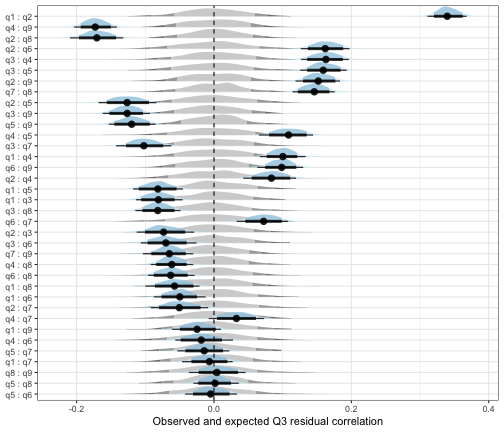
<p class="caption">**Figure 6.** *Q3 residual correlations*</p>
</div>

In the plot, the grey distributions are the replicated Q3 and the points
are the observed Q3. The observed values vary little across draws, because
the residuals given the total score depend only on the item parameters,
which 600 persons estimate precisely. The replicated values also vary
through the sampling of new responses, so they are wider. Each pair has its
own expected value, so the grey distributions are not all centred on the
dashed line.

The largest difference by far is for `q1` and `q2`, the two core symptoms
of depression (little interest and feeling down), with an observed Q3 of
0.24 against about -0.12 replicated. Next, with differences of about 0.15
to 0.2, are `q3` with `q5` and with `q4`, `q7` with `q8`, `q2` with `q9`,
and `q2` with `q6`. All six have `q3_p_adj` below .05, and they match the
two groups in the residual PCA. `q4` with `q5` and `q6` with `q9` follow
at about 0.11, with `q3_ppp` near 1 but `q3_p_adj` above .05.

Pairs with lower residual correlations than replicated are also worth a
look. When items form two groups, items within a group have residual
correlations above the replicated ones and items from different groups
below. Here the lowest pairs, about 0.12 to 0.21 below the replicated
values, are mostly one somatic and one mood item: `q4` with `q9`, `q2` with
`q8`, `q2` with `q5`, `q5` with `q9` and `q3` with `q9`. Together with the positive pairs and the residual PCA,
this points to a somatic and a mood dimension rather than to dependence
between single pairs of items.

## 3. Ordered response categories

`plot_ipf()` shows the probability of each response category across the
latent variable, with the uncertainty as a shaded band. Where two adjacent
curves cross is the threshold between them. A category whose curve is
never the highest is never the most likely response at any location.


``` r
plot_ipf(fit_pcm, theta_range = c(-5, 5))
```

<div class="figure">
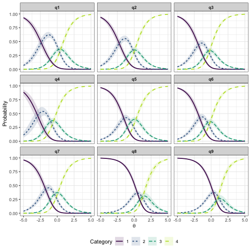
<p class="caption">**Figure 7.** *Item category probability functions*</p>
</div>

`item_parameters()` reports the thresholds, and whether they are in order:


``` r
ipar <- item_parameters(fit_pcm)
knitr::kable(ipar$locations_wide, digits = 2)
```


|item |    t1|    t2|    t3| location|
|:----|-----:|-----:|-----:|--------:|
|q4   | -2.46| -0.55| -0.09|    -1.03|
|q3   | -1.45|  0.01|  0.22|    -0.41|
|q6   | -1.27| -0.08|  0.32|    -0.34|
|q2   | -1.78|  0.28|  0.51|    -0.33|
|q7   | -1.27|  0.02|  0.54|    -0.24|
|q5   | -1.09| -0.07|  0.68|    -0.16|
|q1   | -1.95|  0.62|  0.96|    -0.12|
|q9   |  0.74|  1.63|  1.31|     1.23|
|q8   |  0.90|  1.60|  1.71|     1.40|


``` r
ipar$threshold_order
#> # A tibble: 9 × 4
#>   item  n_thresholds ordered prob_disordered
#>   <chr>        <int> <lgl>             <dbl>
#> 1 q1               3 TRUE             0.0525
#> 2 q2               3 TRUE             0.125 
#> 3 q3               3 TRUE             0.162 
#> 4 q4               3 TRUE             0.0118
#> 5 q5               3 TRUE             0     
#> 6 q6               3 TRUE             0.0243
#> 7 q7               3 TRUE             0.0048
#> 8 q8               3 TRUE             0.336 
#> 9 q9               3 FALSE            0.880
```

The thresholds are in order for all items except `q9`, where the posterior
probability that they are disordered is 0.88. Thresholds 2 and 3 of `q9`
are disordered, so "More than half the days" is never the most likely
response to that item. Together with `q8`, it is the item fewest people
endorse at all.

## 4. Invariance: differential item functioning

`dif_statistic()` refits the model with item-specific differences between
two groups, here women and men, and summarises the posterior of each
item's DIF. A difference in the latent means of the groups (impact) is
estimated separately. DIF is defined relative to the average item, so it
sums to about zero across items, and positive DIF means the item is easier
for the second group (here `"Male"`) at the same latent level. The 31
respondents without gender are left out.


``` r
df_dif <- df_pcm %>% filter(!is.na(gender))

dif <- dif_statistic(fit_pcm, group_var = gender, data = df_dif, rope = 0,
                     cores = 4, refresh = 0, seed = 2024)
saveRDS(dif, "fits/dif_gender_phq9.rds")
```

The DIF model takes a few minutes to fit, so as for the main model, the
saved result is loaded here.


``` r
dif <- readRDS("fits/dif_gender_phq9.rds")
```


``` r
dif$impact
#> # A tibble: 1 × 4
#>   estimate    sd  lower upper
#>      <dbl> <dbl>  <dbl> <dbl>
#> 1   0.0816 0.174 -0.260 0.418
dif$summary
#> # A tibble: 9 × 8
#>   item  dif_estimate dif_sd dif_lower dif_upper    pd rope_percentage flag      
#>   <chr>        <dbl>  <dbl>     <dbl>     <dbl> <dbl>           <dbl> <chr>     
#> 1 q1          0.142   0.152   -0.144    0.453   0.835              NA Inconclus…
#> 2 q2          0.312   0.161    0.0204   0.664   0.982              NA DIF likely
#> 3 q3          0.0297  0.150   -0.262    0.328   0.567              NA Inconclus…
#> 4 q4         -0.210   0.156   -0.533    0.0792  0.926              NA Inconclus…
#> 5 q5         -0.280   0.157   -0.603    0.00590 0.971              NA Inconclus…
#> 6 q6         -0.104   0.147   -0.385    0.183   0.776              NA Inconclus…
#> 7 q7         -0.103   0.150   -0.407    0.185   0.762              NA Inconclus…
#> 8 q8         -0.0456  0.154   -0.349    0.259   0.625              NA Inconclus…
#> 9 q9          0.265   0.157   -0.0219   0.589   0.965              NA Inconclus…
dif$plot
```

<div class="figure">
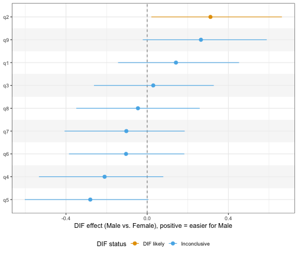
<p class="caption">**Figure 8.** *DIF by gender*</p>
</div>

`rope = 0` reports the posteriors without a region of practical
equivalence. Whether a DIF of a given size matters depends on how the
scores are used, for example through its effect on person locations, so
there is no general cut-off.

The conditional item characteristic curves can be split by group, with the
partial gamma for each item, which measures the association between item
response and group within total-score strata:


``` r
plot_icc(fit_pcm, dif_var = gender, dif_data = df_pcm)
```

<div class="figure">
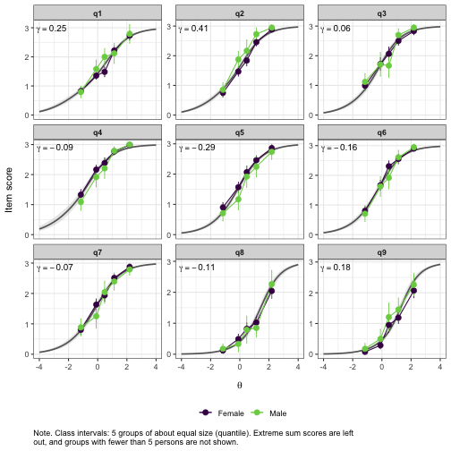
<p class="caption">**Figure 9.** *Conditional ICCs by gender*</p>
</div>

The difference in latent means between men and women (impact) is small
and uncertain, about 0.08 logits with an interval from -0.26 to 0.42. The
largest DIF is for `q2` (feeling down), about 0.3 logits easier for men:
at the same overall level of depression, men report feeling down more
often than women. `q5` (appetite) is harder for men by about the same
amount, and `q9` easier by a little less. For these three items the
probability of direction is about 0.97, so the sign is fairly certain,
while the size is not: the intervals are about 0.6 logits wide. The
partial gamma in the curves points the same way (0.41 for `q2`, -0.29 for
`q5`). Whether differences of this size matter can be judged by their
effect on the person locations, for example by comparing the persons'
locations with and without the items.

## Targeting

`plot_targeting()` shows person locations above the item thresholds on the
same logit scale. The top panel is the distribution of person locations
(EAP by default, `person_estimate = "wle"` for WLE). The bottom panel
draws each item as a bar split into the ranges where each response category
is the most likely response, with the threshold credible intervals below.
A category that is never the most likely response, or disordered
thresholds, are marked in red with the posterior probability of that.
`panel = "thresholds"` gives a simpler threshold plot.


``` r
plot_targeting(fit_pcm, category_labels = resp_labels)
```

<div class="figure">
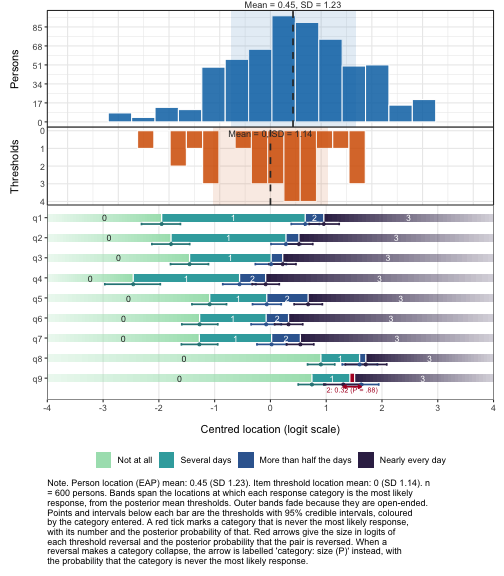
<p class="caption">**Figure 10.** *Person-item targeting*</p>
</div>

The person locations (mean 0.45, SD 1.23) overlap the thresholds well.
This sample was selected to have few respondents without symptoms, see
`?phq9`. The two hardest items, `q8` and `q9`, are located above most
persons. On `q9`, category 2 collapses, as found above, and the arrow gives
the distance between the disordered thresholds and the probability that the category is never
the most likely response.

## Reliability

`RMUreliability()` gives a Bayesian reliability estimate based on relative
measurement uncertainty [RMU, @bignardi_general_2025]. It takes a matrix of
person location draws, persons by draws, and returns the posterior mean
with a 95% highest density continuous interval.


``` r
person_draws <- fit_pcm %>%
  as_draws_df() %>%
  as_tibble() %>%
  select(starts_with("r_id")) %>%
  t()
RMUreliability(person_draws)
#>   rmu_estimate hdci_lowerbound hdci_upperbound .width .point .interval
#> 1    0.8807332       0.8666336       0.8954398   0.95   mean      hdci
```

RMU ranges from 0 to 1, with higher values meaning more reliable person
locations, and can be read like other reliability coefficients. Here it is
0.88, with an interval from 0.87 to 0.90.

## Item and person parameters


``` r
knitr::kable(ipar$summary, digits = 2)
```


|item | threshold| location|   se| hdci_lower| hdci_upper| n_eff|
|:----|---------:|--------:|----:|----------:|----------:|-----:|
|q1   |         1|    -1.95| 0.17|      -2.29|      -1.60|  2860|
|q1   |         2|     0.62| 0.13|       0.37|       0.88|  1178|
|q1   |         3|     0.96| 0.14|       0.68|       1.22|  1834|
|q2   |         1|    -1.78| 0.18|      -2.11|      -1.43|  3081|
|q2   |         2|     0.28| 0.14|       0.02|       0.55|  1289|
|q2   |         3|     0.51| 0.13|       0.25|       0.75|  1393|
|q3   |         1|    -1.45| 0.18|      -1.81|      -1.13|  2611|
|q3   |         2|     0.01| 0.14|      -0.26|       0.29|  1973|
|q3   |         3|     0.22| 0.12|      -0.02|       0.46|  1147|
|q4   |         1|    -2.46| 0.25|      -2.99|      -1.99|  4220|
|q4   |         2|    -0.55| 0.15|      -0.85|      -0.25|  1532|
|q4   |         3|    -0.09| 0.12|      -0.33|       0.15|  1385|
|q5   |         1|    -1.09| 0.16|      -1.40|      -0.78|  2156|
|q5   |         2|    -0.07| 0.13|      -0.32|       0.19|  1824|
|q5   |         3|     0.68| 0.13|       0.42|       0.93|  1460|
|q6   |         1|    -1.27| 0.17|      -1.58|      -0.93|  2441|
|q6   |         2|    -0.08| 0.14|      -0.33|       0.21|  1481|
|q6   |         3|     0.32| 0.13|       0.07|       0.57|  1402|
|q7   |         1|    -1.27| 0.17|      -1.59|      -0.94|  2594|
|q7   |         2|     0.02| 0.14|      -0.24|       0.29|  1712|
|q7   |         3|     0.54| 0.13|       0.29|       0.78|  1262|
|q8   |         1|     0.90| 0.12|       0.66|       1.15|  1206|
|q8   |         2|     1.60| 0.16|       1.27|       1.90|  2093|
|q8   |         3|     1.71| 0.19|       1.34|       2.09|  2838|
|q9   |         1|     0.74| 0.12|       0.49|       0.98|  1223|
|q9   |         2|     1.63| 0.16|       1.31|       1.94|  1852|
|q9   |         3|     1.31| 0.18|       0.96|       1.65|  3054|


`person_parameters()` returns EAP and WLE estimates for each person.
`score_table` maps each total score to a WLE, for persons who answered
every item.


``` r
ppar <- person_parameters(fit_pcm)
knitr::kable(ppar$score_table, digits = 2)
```


| sum_score|  n|   eap| eap_se|   wle| wle_se|
|---------:|--:|-----:|------:|-----:|------:|
|         0|  8| -2.96|   0.72| -4.43|   1.53|
|         1|  4| -2.51|   0.64| -3.21|   0.91|
|         2|  5| -2.16|   0.59| -2.58|   0.73|
|         3|  8| -1.84|   0.54| -2.13|   0.63|
|         4| 11| -1.58|   0.51| -1.78|   0.57|
|         5| 13| -1.34|   0.48| -1.48|   0.52|
|         6| 11| -1.13|   0.46| -1.23|   0.49|
|         7| 25| -0.93|   0.44| -1.01|   0.46|
|         8| 20| -0.75|   0.43| -0.81|   0.44|
|         9| 36| -0.57|   0.41| -0.62|   0.43|
|        10| 16| -0.41|   0.40| -0.45|   0.42|
|        11| 27| -0.25|   0.40| -0.29|   0.41|
|        12| 22| -0.10|   0.39| -0.13|   0.40|
|        13| 24|  0.05|   0.39|  0.03|   0.40|
|        14| 32|  0.20|   0.39|  0.18|   0.40|
|        15| 35|  0.35|   0.39|  0.33|   0.40|
|        16| 31|  0.50|   0.39|  0.49|   0.40|
|        17| 24|  0.65|   0.39|  0.64|   0.40|
|        18| 35|  0.80|   0.40|  0.80|   0.41|
|        19| 29|  0.96|   0.41|  0.97|   0.42|
|        20| 26|  1.13|   0.42|  1.14|   0.43|
|        21| 22|  1.30|   0.43|  1.32|   0.44|
|        22| 23|  1.49|   0.45|  1.51|   0.46|
|        23| 27|  1.70|   0.47|  1.73|   0.49|
|        24| 28|  1.93|   0.51|  1.97|   0.54|
|        25| 23|  2.21|   0.56|  2.28|   0.62|
|        26| 15|  2.56|   0.63|  2.73|   0.78|
|        27| 20|  3.01|   0.73|  3.70|   1.32|


``` r
hist(ppar$person_estimates$eap, col = "lightblue", main = "",
     xlab = "Person location (EAP)")
```

<div class="figure">
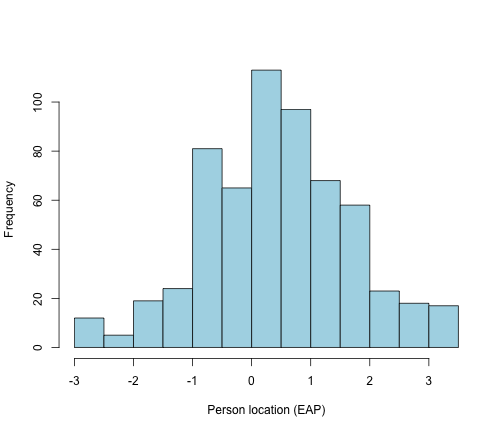
<p class="caption">**Figure 11.** *Distribution of person locations (EAP)*</p>
</div>

## References
